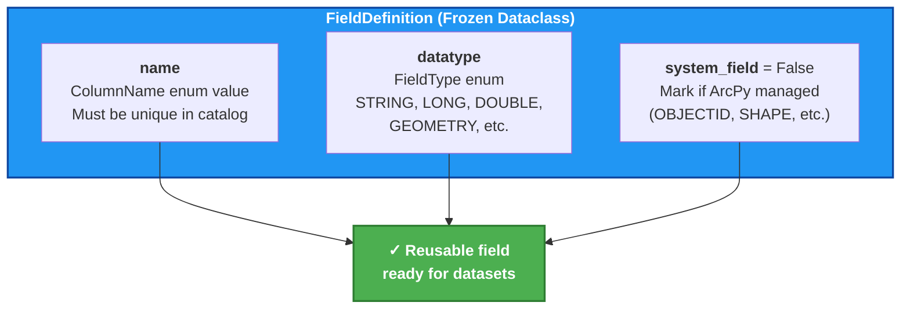
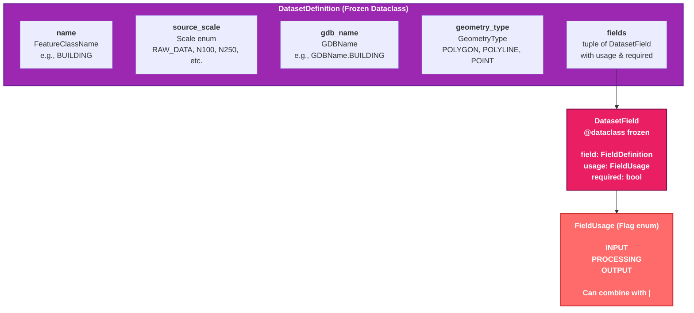
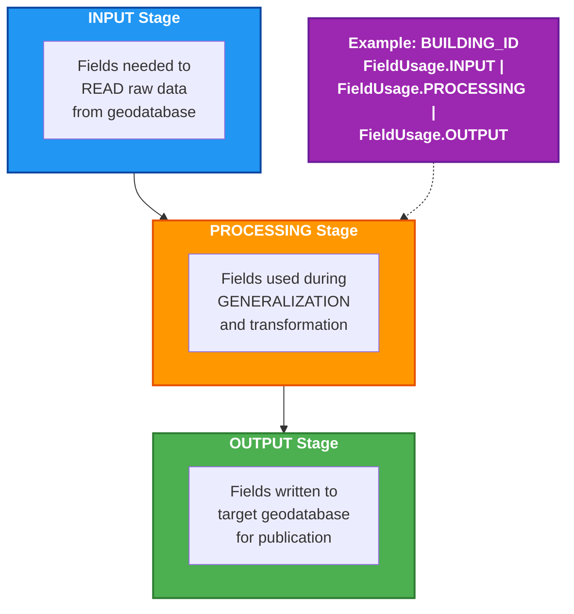
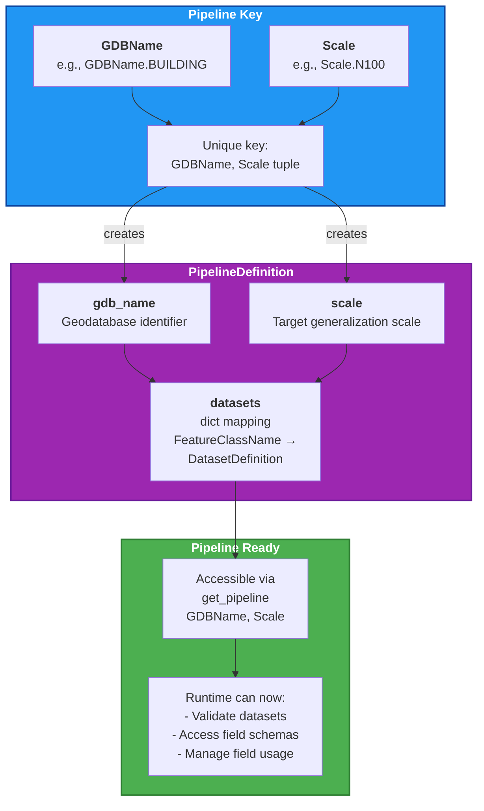
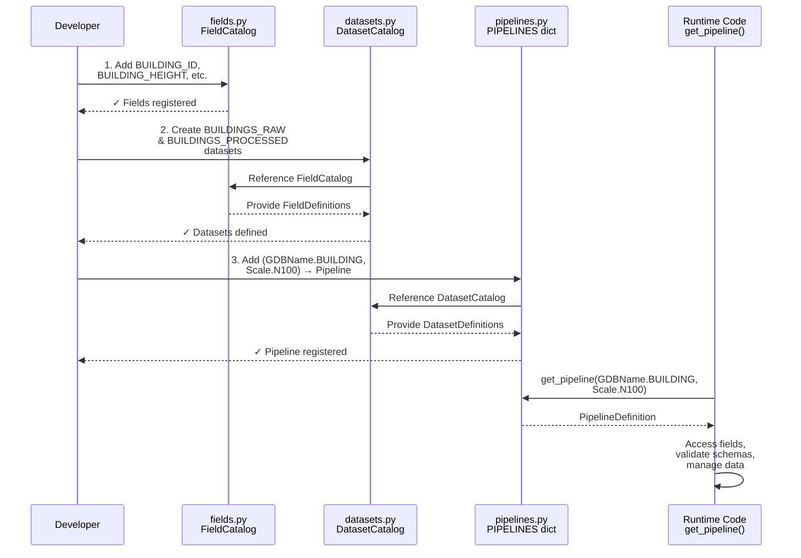

# Adding New Feature Classes - Step-by-Step Guide

A guide to extending `data_orchestrator_2` with new feature classes through the **fields → datasets → pipelines** workflow.

---

## Table of Contents

1. [Overview](#overview)
2. [Prerequisites](#prerequisites)
3. [Step 1: Define Fields](#step-1-define-fields)
4. [Step 2: Create Dataset Definition](#step-2-create-dataset-definition)
5. [Step 3: Register Pipeline](#step-3-register-pipeline)
6. [Complete Example](#complete-example)
7. [Validation & Testing](#validation--testing)

---

## Overview

Adding a new feature class follows a **three-layer progression** through the schema system:


Each layer **builds on the previous one**, ensuring that:
- Fields are reusable across datasets
- Datasets are frozen and immutable
- Pipelines are the entry point for runtime operations

---

## Prerequisites

Before adding a new feature class, ensure:

1. **Constants are defined** in `data_orchestrator_2/constants/`:
   - Add `FeatureClassName` to `fileStructures.py` (if new object type)
   - Add `GDBName` to `fileStructures.py` (if new geodatabase)
   - Add `GeometryType` to `general.py` (if geometry type not already present)
   - Add `ColumnName` values to `columns.py` (for each field)

2. **Example Prerequisites**:
   ```python
   # constants/fileStructures.py
   class FeatureClassName(StrEnum):
       BUILDING = "building"          # New feature class name
       BUILDINGS_PROCESSED = "buildings_processed"
   
   class GDBName(StrEnum):
       BUILDING = "building"           # New GDB name
   
   # constants/columns.py
   class ColumnName(StrEnum):
       BUILDING_ID = "building_id"     # New field name
       BUILDING_HEIGHT = "building_height"
       ROOF_MATERIAL = "roof_material"
   
   # constants/general.py
   class FieldType(StrEnum):
       STRING = "string"
       DOUBLE = "double"
       GEOMETRY = "geometry"
       # (FieldType already has common types)
   ```

---

## Step 1: Define Fields

**File**: `data_orchestrator_2/schemas/fields.py`  
**Class**: `FieldCatalog`

All fields used in your datasets must be registered in the `FieldCatalog`.

### Add Field Definitions

```python
# In FieldCatalog class, add your new fields:

class FieldCatalog:
    """Reusable field definitions for dataset catalogs."""
    
    # Existing fields...
    OBJECTID = FieldDefinition(
        name=ColumnName.OBJECTID,
        datatype=FieldType.OID,
        system_field=True,
    )
    
    # NEW FIELDS ↓
    BUILDING_ID = FieldDefinition(
        name=ColumnName.BUILDING_ID,
        datatype=FieldType.LONG,
    )
    
    BUILDING_HEIGHT = FieldDefinition(
        name=ColumnName.BUILDING_HEIGHT,
        datatype=FieldType.DOUBLE,
    )
    
    ROOF_MATERIAL = FieldDefinition(
        name=ColumnName.ROOF_MATERIAL,
        datatype=FieldType.STRING,
    )
    
    SHAPE = FieldDefinition(
        name=ColumnName.SHAPE,
        datatype=FieldType.GEOMETRY,
        system_field=True,
    )
```

### Field Definition Structure



### Key Points

- **Every field must exist in `FieldCatalog`** before it can be used in a dataset
- Fields are **frozen dataclasses** (immutable)
- Mark ArcPy-managed fields with `system_field=True` (e.g., OBJECTID, SHAPE)
- Field names must correspond to actual geodatabase column names

---

## Step 2: Create Dataset Definition

**File**: `data_orchestrator_2/schemas/datasets.py`  
**Class**: `DatasetCatalog`

A dataset combines fields with their usage patterns and source metadata.

### Add Dataset Definition

```python
# In DatasetCatalog class, add your new dataset:

class DatasetCatalog:
    """Named dataset definitions available to pipelines."""
    
    # Existing datasets...
    
    # NEW DATASET ↓
    BUILDINGS_RAW = DatasetDefinition(
        name=FeatureClassName.BUILDING,
        source_scale=Scale.RAW_DATA,
        gdb_name=GDBName.BUILDING,
        geometry_type=GeometryType.POLYGON,
        fields=(
            used_for(FieldCatalog.OBJECTID, FieldUsage.INPUT),
            used_for(FieldCatalog.SHAPE, FieldUsage.INPUT),
            used_for(
                FieldCatalog.BUILDING_ID,
                FieldUsage.INPUT | FieldUsage.PROCESSING | FieldUsage.OUTPUT,
                required=True,
            ),
            used_for(
                FieldCatalog.BUILDING_HEIGHT,
                FieldUsage.INPUT | FieldUsage.PROCESSING,
                required=False,
            ),
            used_for(
                FieldCatalog.ROOF_MATERIAL,
                FieldUsage.INPUT | FieldUsage.PROCESSING,
                required=False,
            ),
        ),
    )
    
    BUILDINGS_PROCESSED = DatasetDefinition(
        name=FeatureClassName.BUILDINGS_PROCESSED,
        source_scale=Scale.N100,
        gdb_name=GDBName.BUILDING,
        geometry_type=GeometryType.POLYGON,
        fields=(
            used_for(FieldCatalog.OBJECTID, FieldUsage.OUTPUT),
            used_for(FieldCatalog.SHAPE, FieldUsage.OUTPUT),
            used_for(FieldCatalog.BUILDING_ID, FieldUsage.OUTPUT, required=True),
            used_for(FieldCatalog.BUILDING_HEIGHT, FieldUsage.OUTPUT, required=False),
        ),
    )
```

### Dataset Definition Structure



### Field Usage Patterns



### Key Points

- Each dataset maps to **one feature class** at **one source scale**
- The `used_for()` helper function combines `FieldDefinition`, `FieldUsage`, and `required` status
- Fields marked `required=True` must always be present
- System fields (OBJECTID, SHAPE) are typically INPUT-only
- Datasets are **frozen** and changes require careful review

---

## Step 3: Register Pipeline

**File**: `data_orchestrator_2/schemas/pipelines.py`  
**Dictionary**: `PIPELINES`

Pipelines connect datasets to a target scale and geodatabase.

### Add Pipeline Entry

```python
# In the PIPELINES dictionary, add your new pipeline:

PIPELINES: dict[tuple[GDBName, Scale], PipelineDefinition] = {
    # Existing pipelines...
    (GDBName.ROAD, Scale.N100): PipelineDefinition(
        gdb_name=GDBName.ROAD,
        scale=Scale.N100,
        datasets={FeatureClassName.ELVEG_AND_STI: DatasetCatalog.ELVEG_AND_STI},
    ),
    
    # NEW PIPELINE ↓
    (GDBName.BUILDING, Scale.N100): PipelineDefinition(
        gdb_name=GDBName.BUILDING,
        scale=Scale.N100,
        datasets={
            FeatureClassName.BUILDING: DatasetCatalog.BUILDINGS_RAW,
            FeatureClassName.BUILDINGS_PROCESSED: DatasetCatalog.BUILDINGS_PROCESSED,
        },
    ),
}
```

### Pipeline Registration Pattern



### Key Points

- Pipeline key is **(GDBName, Scale)** — this uniquely identifies a generalization pipeline
- One pipeline can contain **multiple datasets** (e.g., raw input + processed output)
- The `get_pipeline()` function looks up pipelines by this key
- Adding a pipeline makes the dataset schemas **discoverable at runtime**

---

## Complete Example

Adding a **Building feature class** with raw and processed datasets:

### 1. Update Constants

```python
# constants/fileStructures.py
class FeatureClassName(StrEnum):
    BUILDING = "building"
    BUILDINGS_PROCESSED = "buildings_processed"

class GDBName(StrEnum):
    BUILDING = "building"

# constants/columns.py
class ColumnName(StrEnum):
    BUILDING_ID = "building_id"
    BUILDING_HEIGHT = "building_height"
    ROOF_MATERIAL = "roof_material"
```

### 2. Add Fields to FieldCatalog

```python
# schemas/fields.py
class FieldCatalog:
    BUILDING_ID = FieldDefinition(
        name=ColumnName.BUILDING_ID,
        datatype=FieldType.LONG,
    )
    
    BUILDING_HEIGHT = FieldDefinition(
        name=ColumnName.BUILDING_HEIGHT,
        datatype=FieldType.DOUBLE,
    )
    
    ROOF_MATERIAL = FieldDefinition(
        name=ColumnName.ROOF_MATERIAL,
        datatype=FieldType.STRING,
    )
```

### 3. Create Dataset Definitions

```python
# schemas/datasets.py
class DatasetCatalog:
    BUILDINGS_RAW = DatasetDefinition(
        name=FeatureClassName.BUILDING,
        source_scale=Scale.RAW_DATA,
        gdb_name=GDBName.BUILDING,
        geometry_type=GeometryType.POLYGON,
        fields=(
            used_for(FieldCatalog.OBJECTID, FieldUsage.INPUT),
            used_for(FieldCatalog.SHAPE, FieldUsage.INPUT),
            used_for(
                FieldCatalog.BUILDING_ID,
                FieldUsage.INPUT | FieldUsage.PROCESSING | FieldUsage.OUTPUT,
                required=True,
            ),
            used_for(
                FieldCatalog.BUILDING_HEIGHT,
                FieldUsage.INPUT | FieldUsage.PROCESSING | FieldUsage.OUTPUT,
            ),
            used_for(
                FieldCatalog.ROOF_MATERIAL,
                FieldUsage.INPUT | FieldUsage.PROCESSING,
            ),
        ),
    )
    
    BUILDINGS_PROCESSED = DatasetDefinition(
        name=FeatureClassName.BUILDINGS_PROCESSED,
        source_scale=Scale.N100,
        gdb_name=GDBName.BUILDING,
        geometry_type=GeometryType.POLYGON,
        fields=(
            used_for(FieldCatalog.OBJECTID, FieldUsage.OUTPUT),
            used_for(FieldCatalog.SHAPE, FieldUsage.OUTPUT),
            used_for(
                FieldCatalog.BUILDING_ID,
                FieldUsage.OUTPUT,
                required=True,
            ),
            used_for(
                FieldCatalog.BUILDING_HEIGHT,
                FieldUsage.OUTPUT,
            ),
        ),
    )
```

### 4. Register Pipeline

```python
# schemas/pipelines.py
PIPELINES: dict[tuple[GDBName, Scale], PipelineDefinition] = {
    (GDBName.ROAD, Scale.N100): PipelineDefinition(...),
    
    # NEW
    (GDBName.BUILDING, Scale.N100): PipelineDefinition(
        gdb_name=GDBName.BUILDING,
        scale=Scale.N100,
        datasets={
            FeatureClassName.BUILDING: DatasetCatalog.BUILDINGS_RAW,
            FeatureClassName.BUILDINGS_PROCESSED: DatasetCatalog.BUILDINGS_PROCESSED,
        },
    ),
}
```

### 5. Use in Runtime Code

```python
# Any module importing pipelines can now use:
from data_orchestrator_2.schemas.pipelines import get_pipeline
from data_orchestrator_2.constants.fileStructures import GDBName
from data_orchestrator_2.constants.general import Scale

# Get the pipeline
pipeline = get_pipeline(GDBName.BUILDING, Scale.N100)

# Access datasets
buildings_raw = pipeline.getDataset(FeatureClassName.BUILDING)
buildings_processed = pipeline.getDataset(FeatureClassName.BUILDINGS_PROCESSED)

# Query field schemas
input_fields = buildings_raw.getFieldsFor(FieldUsage.INPUT)
output_fields = buildings_processed.getFieldsFor(FieldUsage.OUTPUT)
```

---

## Workflow Visualization

The complete flow from definition to runtime usage:


