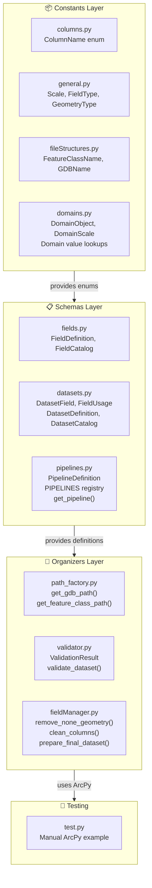
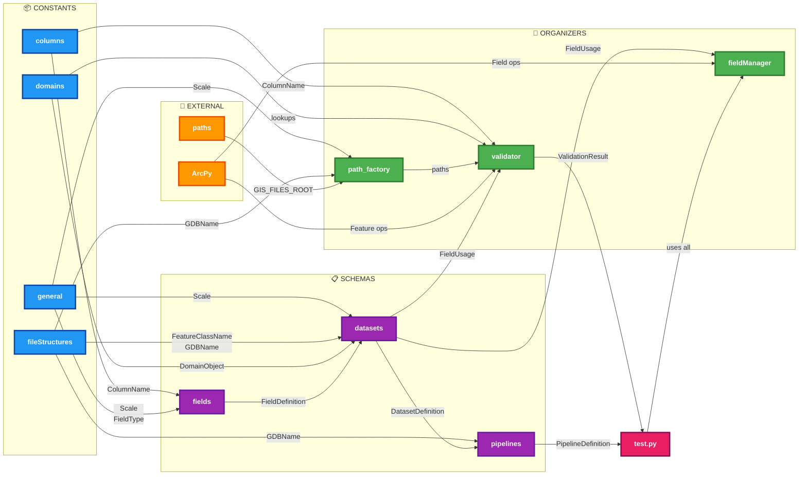
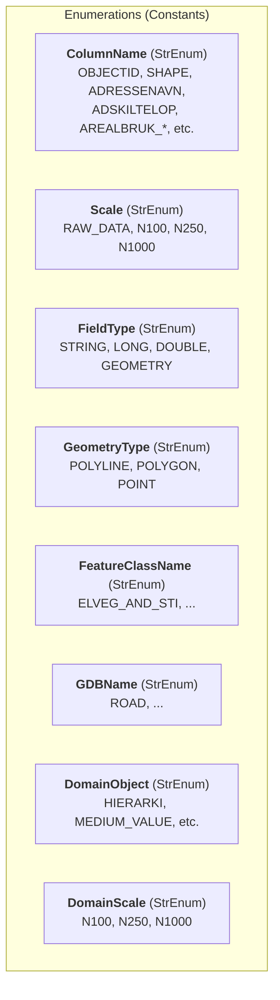
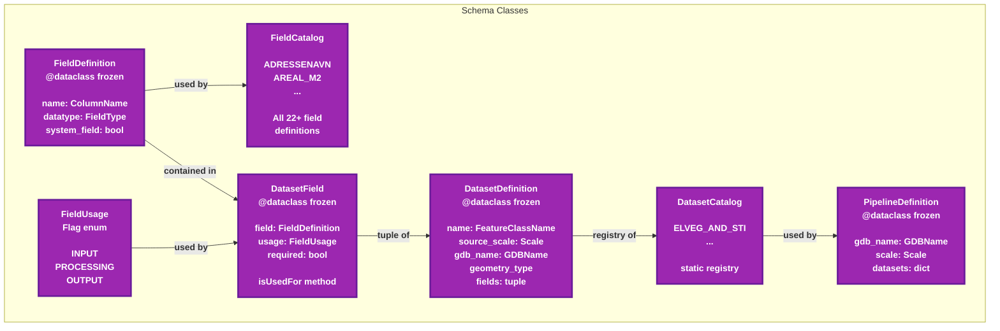
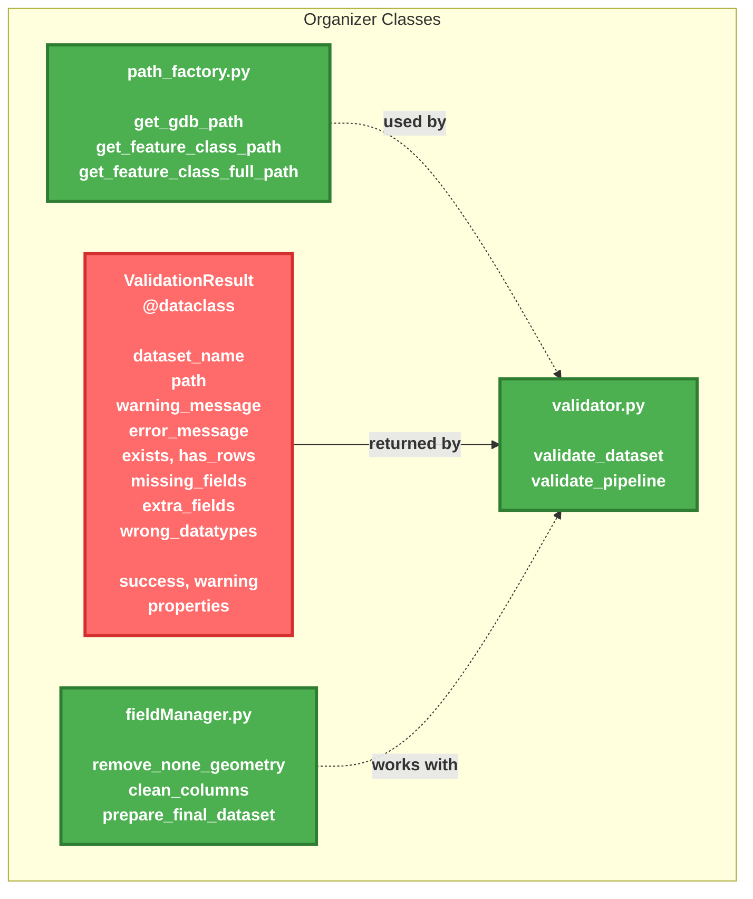
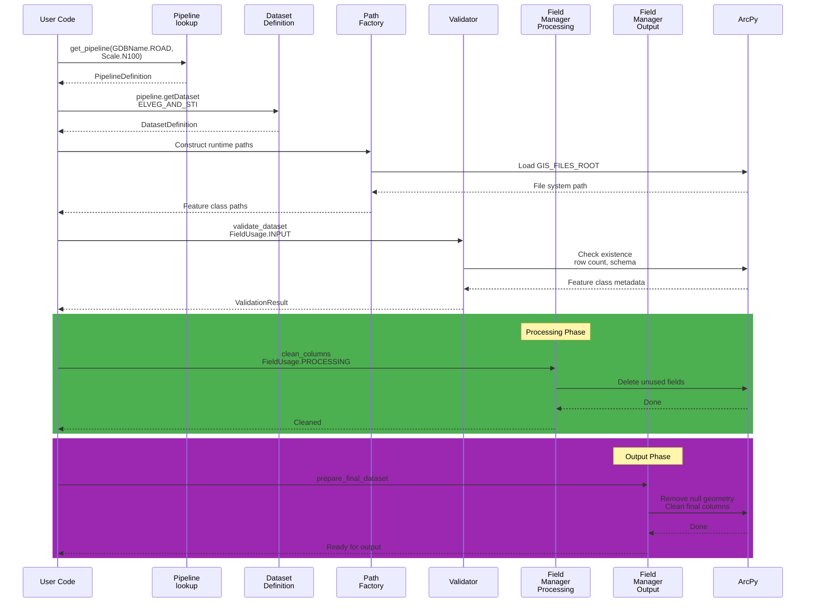

# Data Orchestrator 2 - Architecture & Module Dependencies

A comprehensive guide to the `data_orchestrator_2` module structure, class hierarchies, and component dependencies.

---

## Table of Contents

1. [Overview](#overview)
2. [Architecture Layers](#architecture-layers)
3. [Module Dependencies](#module-dependencies)
4. [Class Hierarchy & Relationships](#class-hierarchy--relationships)
5. [Data Flow](#data-flow)
6. [Key Components](#key-components)
7. [Usage Examples](#usage-examples)

---

## Overview

`data_orchestrator_2` separates **catalog definitions** (pipeline and dataset schemas) from **runtime operations** (dataset paths and ArcPy interactions). The module is organized into four main layers:

- **Constants Layer**: Type enums and static definitions
- **Schemas Layer**: Frozen catalog definitions and lookups
- **Organizers Layer**: Runtime operations (path resolution, validation, field management)
- **Core Entry Point**: The `test.py` manual example

A pipeline is uniquely selected by `(GDBName, Scale)`. Each dataset definition records its source scale, geometry type, and field catalog.

---

## Architecture Layers



---

## Module Dependencies

### Complete Dependency Graph



---

## Class Hierarchy & Relationships

### Constants Layer



### Schemas Layer



### Organizers Layer



---

## Data Flow

### Pipeline Initialization & Validation



### Schema Catalog Lookup


---

## Key Components

### 1. Constants (`constants/`)

| File | Purpose | Key Exports |
|------|---------|-------------|
| `columns.py` | Column name enum | `ColumnName` (StrEnum) |
| `general.py` | Core enumerations | `Scale`, `FieldType`, `GeometryType` |
| `fileStructures.py` | Feature class & GDB names | `FeatureClassName`, `GDBName` |
| `domains.py` | Domain value lookups | `DomainObject`, `DomainScale`, `get_allowed_values()` |

**Note**: Enums enable type-safe lookups and prevent string-based errors.

### 2. Schemas (`schemas/`)

| File | Class/Function | Responsibility |
|------|---|---|
| `fields.py` | `FieldDefinition` | Immutable field metadata (name, type, system flag) |
| `fields.py` | `FieldCatalog` | Registry of all reusable field definitions |
| `datasets.py` | `FieldUsage` | Flag enum for INPUT/PROCESSING/OUTPUT stages |
| `datasets.py` | `DatasetField` | Field with usage and requiredness flags |
| `datasets.py` | `DatasetDefinition` | Immutable dataset schema with field lookup |
| `datasets.py` | `DatasetCatalog` | Registry of all known datasets |
| `pipelines.py` | `PipelineDefinition` | Target scale and its datasets |
| `pipelines.py` | `PIPELINES` dict | `(GDBName, Scale) -> PipelineDefinition` registry |
| `pipelines.py` | `get_pipeline()` | Lookup a pipeline by key; raises `KeyError` if missing |

**Design Principle**: All schema classes are frozen `@dataclass` instances to ensure immutability.

### 3. Organizers (`organizers/`)

| File | Function | Responsibility |
|------|----------|---|
| `path_factory.py` | `get_gdb_path()` | Build GDB path from `GIS_FILES_ROOT`, scale, and GDB name |
| `path_factory.py` | `get_feature_class_path()` | Append feature class name to GDB path |
| `path_factory.py` | `get_feature_class_full_path()` | One-shot function combining both above |
| `validator.py` | `ValidationResult` | Report existence, row count, schema, and type checks |
| `validator.py` | `validate_dataset()` | Check a single dataset against its definition |
| `validator.py` | `validate_pipeline()` | Validate all datasets in a pipeline; aggregate results |
| `fieldManager.py` | `remove_none_geometry()` | Delete rows with null geometry; timestamp and report |
| `fieldManager.py` | `clean_columns()` | Delete unregistered or unused fields; preserve system fields |
| `fieldManager.py` | `prepare_final_dataset()` | Combined cleanup for final output (remove geometry + clean cols) |

**Dependencies**:
- `path_factory.py` imports only constants and `paths.py` (external).
- `validator.py` requires `custom_tools.general_tools.validation` helpers and ArcPy.
- `fieldManager.py` requires ArcPy and accesses dataset paths and definitions.

### 4. Test Entry Point (`test.py`)

Manual ArcPy example that:
1. Imports pipeline and dataset definitions
2. Validates input stage
3. Copies dataset to output path
4. Redirects runtime dataset to the copy
5. Validates processing stage
6. Prepares final dataset

**Not an automated pytest test**; run as a script for manual validation.

---

## Usage Examples

### Example 1: Access Pipeline Definition

```python
from data_orchestrator_2.constants.fileStructures import GDBName
from data_orchestrator_2.constants.general import Scale
from data_orchestrator_2.constants.fileStructures import FeatureClassName
from data_orchestrator_2.schemas.pipelines import get_pipeline

# Look up pipeline
pipeline = get_pipeline(GDBName.ROAD, Scale.N100)
print(f"Pipeline: {pipeline.scale} / {pipeline.gdb_name}")

# Get dataset from pipeline
dataset_def = pipeline.getDataset(FeatureClassName.ELVEG_AND_STI)
print(f"Dataset: {dataset_def.name}, {len(dataset_def.fields)} fields")

# List all fields
for field in dataset_def.fields:
    print(f"  - {field.name}: {field.datatype} (required={field.required})")
```

### Example 2: Validate a Dataset

```python
from data_orchestrator_2.organizers.validator import validate_dataset
from data_orchestrator_2.schemas.datasets import FieldUsage
from data_orchestrator_2.organizers.path_factory import get_feature_class_full_path

# Build path
path = get_feature_class_full_path(
    scale=Scale.RAW_DATA,
    gdb_name=GDBName.ROAD,
    feature_class_name=FeatureClassName.ELVEG_AND_STI
)

# Validate
result = validate_dataset(
    dataset=dataset_def,
    path=path,
    usage=FieldUsage.INPUT
)

if result.success:
    print(f"✓ {result.dataset_name} is valid for input")
else:
    print(f"✗ {result.dataset_name}: {result.error_message}")
    print(f"  Missing fields: {result.missing_fields}")
    print(f"  Wrong types: {result.wrong_datatypes}")
```

### Example 3: Field Management

```python
from data_orchestrator_2.organizers.fieldManager import clean_columns, prepare_final_dataset

class MockDataset:
    """Mock dataset with path and definition."""
    def __init__(self, path, definition):
        self.path = path
        self.definition = definition

# Prepare final output
dataset_obj = MockDataset(path, dataset_def)
prepare_final_dataset(dataset_obj)
# Removes null-geometry rows and deletes non-OUTPUT fields
```

---

## Initialization Flow

When the `data_orchestrator_2` module is imported:

1. **Constants** are defined as frozen enums.
2. **Schemas** are loaded: field definitions, dataset catalog, pipeline registry.
3. **Organizers** functions are registered (no side effects).
4. **Test.py** does not run automatically; manual invocation required.

**No ArcPy imports at module level**: ArcPy is lazily imported by organizers and only when validation/cleanup is needed.

---

## Summary

| Layer | Role | Depends On | Side Effects |
|-------|------|-----------|---|
| **Constants** | Type-safe enumerations | Nothing | None |
| **Schemas** | Immutable catalog definitions | Constants | None |
| **Organizers** | Runtime operations | Schemas, Constants, ArcPy | File I/O, ArcPy mutations |
| **Test** | Manual example | All layers, ArcPy | Copies datasets, modifies features |

**Key Insight**: Catalog definitions (Constants + Schemas) have zero external dependencies and can be inspected without ArcPy. Runtime operations (Organizers) require ArcPy and configured paths.
