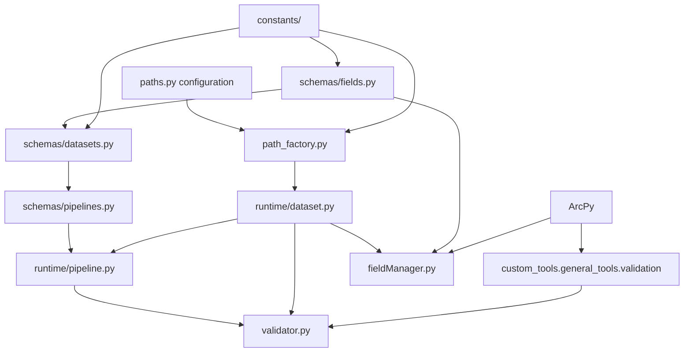

# Data Orchestrator 2

`data_orchestrator_2` separates pipeline and dataset catalog definitions from runtime dataset paths and ArcPy operations. A catalog pipeline is selected by `(object_type, target scale)`. Each dataset definition records its own source scale, object type, geometry type, and fields.

## Dependency Flow



`path_factory.py` imports `paths.GIS_FILES_ROOT`. Importing catalog definitions therefore requires the path configuration loaded by `paths.py`: `DEFAULT_PROJECT_WORKSPACE`, `GIS_FILES_ROOT`, and `PYTHONPATH` must be set directly or through `.env`. Dataset paths are derived as:

```text
<GIS_FILES_ROOT>/<source_scale>/<object_type>.gdb/<feature_class_name>
```

The current catalog has one pipeline, `(ROAD, N100)`, with one `ELVEG_AND_STI` polyline dataset at source scale `RAW_DATA`. The dataset registers 22 fields. ArcPy is required for validation and field management, but not to inspect catalog definitions once path configuration is available.

## Definitions And Runtime

`schemas/fields.py` defines `FieldUsage`, immutable `FieldDefinition` records, and the reusable `FieldCatalog`. Usage flags can be combined; `isUsedFor(usage)` matches any requested flag. `required` controls validation, and `system_field` marks fields that column cleanup preserves.

`schemas/datasets.py` defines immutable `DatasetDefinition` records. It normalizes fields to a tuple, rejects duplicate field names, provides a read-only field lookup, and returns field names in catalog order. `schemas/pipelines.py` stores `PipelineDefinition` values and looks them up with `get_pipeline(object_type, scale)`, which raises `KeyError` for an unknown key.

`runtime/pipeline.py` wraps a pipeline definition and constructs a runtime `Dataset` for each catalog entry. `runtime/dataset.py` holds the mutable dataset path; `set_path(path)` can redirect ArcPy operations to a copied or staged feature class without changing the catalog definition.

```python
from data_orchestrator_2.constants.common import Scale
from data_orchestrator_2.constants.featureClasses import ObjectType
from data_orchestrator_2.runtime.pipeline import Pipeline
from data_orchestrator_2.schemas.fields import FieldUsage
from data_orchestrator_2.schemas.pipelines import get_pipeline
from data_orchestrator_2.validator import validate_pipeline

pipeline = Pipeline(get_pipeline(ObjectType.ROAD, Scale.N100))
for dataset in pipeline.datasets.values():
    print(dataset.definition.name, dataset.path)
    print(dataset.definition.getFieldsFor(FieldUsage.INPUT))

results = validate_pipeline(pipeline, FieldUsage.INPUT)  # Requires ArcPy
for result in results:
    print(result)
```

The manual, read-only version of this example is [test.py](test.py). It runs only when executed as a script; importing it does not start validation.

## Field Roles

All fields listed by the current `ELVEG_AND_STI` dataset are input and processing fields. `OBJECTID`, `SHAPE`, and `SHAPE_Length` are also marked for output and as system fields. `ER_KRYSSNINGSPUNKT` and `HIERARKI` exist in `FieldCatalog` as processing-only definitions but are not registered on this dataset yet.

`DatasetDefinition.getField(name)` raises `KeyError` for an unregistered name. Field lookups are case-sensitive at the catalog API; ArcPy validation and cleanup match actual field names case-insensitively.

## Operations

| Module | Responsibility |
| --- | --- |
| `constants/` | Scale, object type, feature-class name, geometry, field type, field name, and domain values. |
| `path_factory.py` | Build geodatabase and feature-class paths from configured root and enums. |
| `schemas/fields.py` | Field roles and reusable field definitions. |
| `schemas/datasets.py` | Dataset metadata and the dataset catalog. |
| `schemas/pipelines.py` | Pipeline metadata and `(object_type, target scale)` lookup. |
| `runtime/dataset.py` | Mutable runtime path for a dataset definition. |
| `runtime/pipeline.py` | Runtime datasets constructed from a pipeline definition. |
| `validator.py` | Read-only existence, row, required-field, extra-field, and field-type checks. |
| `fieldManager.py` | Remove null-geometry rows and delete fields not retained for a usage stage. |
| `test.py` | Manual catalog and validation example; not an automated test. |

`validate_pipeline(pipeline, usage)` returns one `ValidationResult` per runtime dataset. Success requires an existing dataset with rows, no missing required fields, and no type mismatches. Missing optional fields are allowed; extra fields set `warning` but do not fail success. Field matching is case-insensitive. Geometry type is not checked separately. The shared validation helpers catch ArcPy inspection errors and return false or an empty field set, so such errors appear as failed checks rather than propagating.

`clean_columns(dataset, usage)` deletes unknown or unregistered fields and registered fields not used for any requested flag. It preserves ArcPy-required fields and catalog system fields. `remove_none_geometry(dataset)` deletes rows with null geometry. `prepare_final_dataset(dataset)` performs both operations and cleans columns for `FieldUsage.OUTPUT`. These functions mutate data, print timestamped summaries, return `None`, and require ArcPy; use `FieldUsage.OUTPUT` alone for final-output cleanup.

The package is outside the repository's configured Pyright include roots (`src`, `tests`, and `tools`). `test.py` is a manual example, not part of the automated pytest collection. Focused automated tests should mock ArcPy inspection/deletion calls or run in an ArcGIS Pro Python environment.