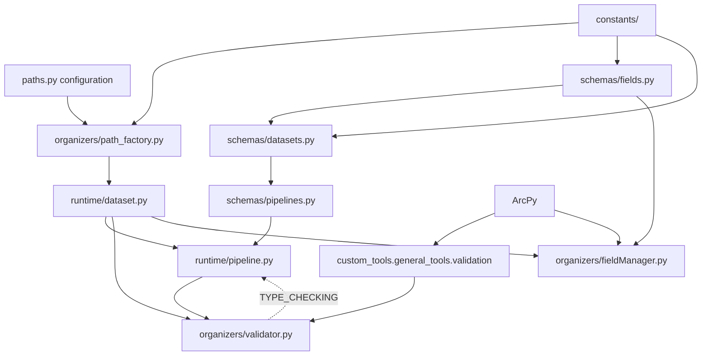

# Data Orchestrator 2

`data_orchestrator_2` separates pipeline and dataset catalog definitions from runtime dataset paths and ArcPy operations. A catalog pipeline is selected by `(object_type, target scale)`. Each dataset definition records its own source scale, object type, geometry type, and fields.

## Dependency Flow



`organizers/path_factory.py` imports `paths.GIS_FILES_ROOT`; constructing a runtime `Dataset` therefore loads `paths.py`, which requires `DEFAULT_PROJECT_WORKSPACE`, `GIS_FILES_ROOT`, and `PYTHONPATH` to be set directly or through `.env`. Catalog definitions in `schemas/` do not themselves depend on this path configuration. Runtime dataset paths are derived as:

```text
<GIS_FILES_ROOT>/<source_scale>/<object_type>.gdb/<feature_class_name>
```

The current catalog has one pipeline, `(ROAD, N100)`, with one `ELVEG_AND_STI` polyline dataset at source scale `RAW_DATA`. The dataset registers 22 fields. ArcPy is required for validation and field management, but not to inspect the schema catalog.

## Definitions And Runtime

`schemas/fields.py` defines `FieldUsage`, frozen `FieldDefinition` records, and the reusable `FieldCatalog`. Usage flags can be combined; `isUsedFor(usage)` matches any requested flag. `required` controls missing-field validation, `system_field` marks fields that column cleanup preserves, and `domain` can associate a field with a `StrEnum` from `constants/domains.py`.

`schemas/datasets.py` defines frozen `DatasetDefinition` records. It normalizes fields to a tuple, rejects duplicate field names, provides a read-only lookup by `ColumnName`, and returns field names in catalog order. `schemas/pipelines.py` stores `PipelineDefinition` values and looks them up with `get_pipeline(object_type, scale)`, which raises `KeyError` for an unknown key.

`runtime/pipeline.py` looks up a pipeline from `(object_type, scale)`, constructs a runtime `Dataset` for each catalog entry, and exposes `validInput()`, `validProcessing()`, and `validOutput()` validation stages. `runtime/dataset.py` holds the mutable dataset path; `set_path(path)` can redirect ArcPy operations to a copied or staged feature class without changing the catalog definition and resets its validated/error/warning flags.

```python
from data_orchestrator_2.constants.common import Scale
from data_orchestrator_2.constants.featureClasses import FeatureClassName, ObjectType
from data_orchestrator_2.runtime.pipeline import Pipeline

pipeline = Pipeline(ObjectType.ROAD, Scale.N100)
pipeline.validInput()  # Requires ArcPy and configured paths.

dataset = pipeline.getDataset(FeatureClassName.ELVEG_AND_STI)
print(dataset.path, dataset.error, dataset.warning)
```

The manual example is [test.py](test.py). When run as a script, it validates input, copies the dataset to a configured example output path, redirects the runtime dataset to that copy, and validates it for processing. Importing the module does not run the example.

## Field Roles

All 22 fields listed by the current `ELVEG_AND_STI` dataset are used for input and processing. `OBJECTID` and `SHAPE` are also marked for output and as system fields; `SHAPE_Length` is processing/output and a system field. `ER_KRYSSNINGSPUNKT` and `HIERARKI` exist in `FieldCatalog` as processing-only definitions but are not registered on this dataset yet.

`DatasetDefinition.getField(name)` raises `KeyError` for an unregistered `ColumnName`; catalog lookups use enum keys. ArcPy validation and cleanup match actual field names case-insensitively.

## Operations

| Module | Responsibility |
| --- | --- |
| `constants/` | Scale, object type, feature-class name, geometry, field type, field name, and domain enums. |
| `organizers/path_factory.py` | Build geodatabase and feature-class paths from configured root and enums. |
| `schemas/fields.py` | Field roles and reusable field definitions. |
| `schemas/datasets.py` | Dataset metadata and the dataset catalog. |
| `schemas/pipelines.py` | Pipeline metadata and `(object_type, target scale)` lookup. |
| `runtime/dataset.py` | Mutable runtime path for a dataset definition. |
| `runtime/pipeline.py` | Runtime datasets, validation stages, and aggregate pipeline status. |
| `organizers/validator.py` | Read-only existence, row, required-field, extra-field, and field-type checks. |
| `organizers/fieldManager.py` | Remove null-geometry rows and delete fields not retained for a usage stage. |
| `test.py` | Manual ArcPy example that copies, redirects, and validates a dataset. |

`organizers/validator.py`'s `validate_pipeline(pipeline, usage)` returns one `ValidationResult` per runtime dataset. Success requires an existing dataset with rows, no missing required fields, and no type mismatches. Missing optional fields are allowed; extra fields set `warning` but do not fail success. Field names and data types are compared case-insensitively. Geometry type is not checked separately. The shared validation helpers catch ArcPy inspection errors and return false or an empty field set, so such errors appear as failed checks rather than propagating. `runtime/pipeline.py` applies these results to each `Dataset` and aggregates error and warning status on the pipeline.

`organizers/fieldManager.py`'s `clean_columns(dataset, usage)` deletes unknown or unregistered fields and registered fields not used for any requested flag. It preserves ArcPy-required fields and catalog system fields. `remove_none_geometry(dataset)` deletes rows with null geometry. `prepare_final_dataset(dataset)` performs both operations and cleans columns for `FieldUsage.OUTPUT`. These functions mutate data, print timestamped summaries, return `None`, and require ArcPy; use `FieldUsage.OUTPUT` alone for final-output cleanup.

`test.py` is a manual script, not an automated pytest test. Automated tests for the ArcPy-dependent operations should mock ArcPy inspection/deletion calls or run in an ArcGIS Pro Python environment.