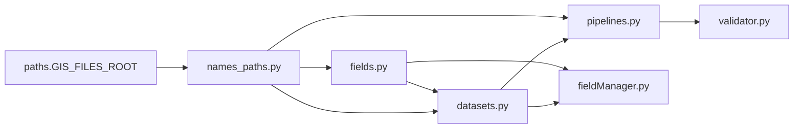
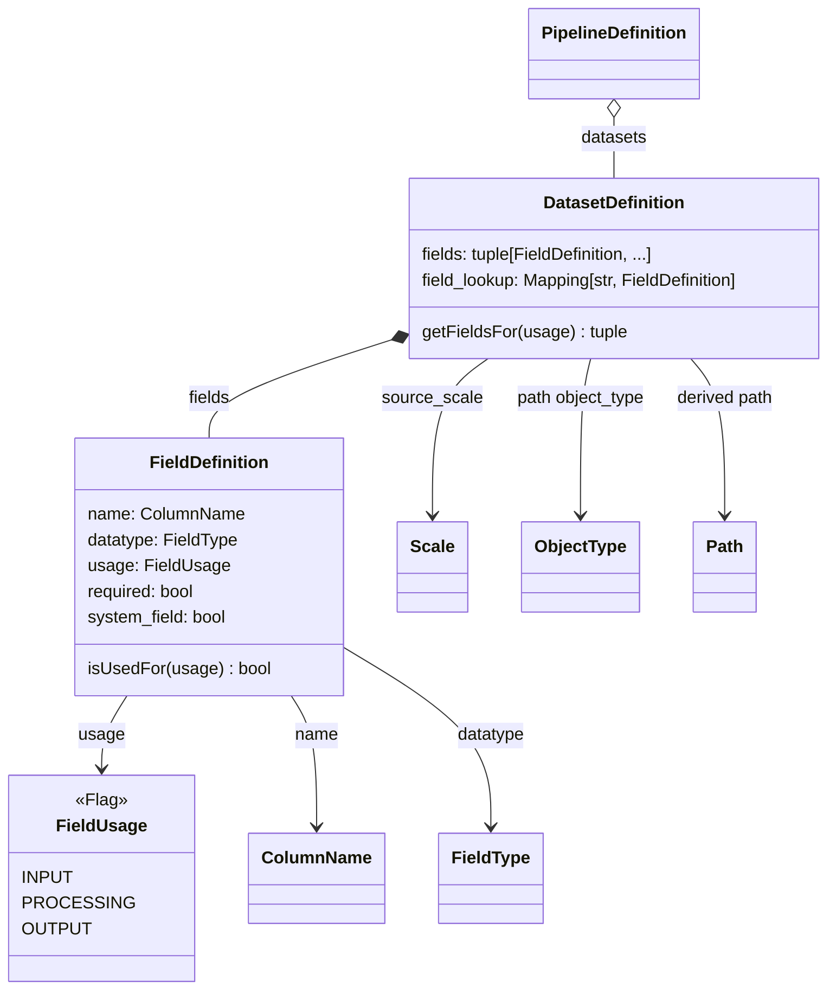

# Data Orchestrator 2

`data_orchestrator_2` catalogs datasets for generalization pipelines. A pipeline is selected by `(object_type, target scale)`; each dataset has its own source scale, object type, geometry, derived path, and field definitions. The target scale and source scale are separate values.

## Access Path



`names_paths.py` imports `paths.GIS_FILES_ROOT` at import time. `paths.py` loads `.env` and requires `DEFAULT_PROJECT_WORKSPACE`, `GIS_FILES_ROOT`, and `PYTHONPATH`, even for callers that only need catalog enums. ArcPy is needed for validation and field management, but not for catalog lookup.

```python
from data_orchestrator_2.fields import FieldUsage
from data_orchestrator_2.names_paths import ObjectType, Scale
from data_orchestrator_2.pipelines import get_pipeline
from data_orchestrator_2.validator import validate_pipeline

pipeline = get_pipeline(ObjectType.ROAD, Scale.N100)
for dataset in pipeline.datasets:
    print(dataset.name, dataset.path, dataset.getFieldsFor(FieldUsage.INPUT))

results = validate_pipeline(pipeline, FieldUsage.INPUT)  # Requires ArcPy
```

`get_pipeline` uses a dictionary keyed by `(ObjectType, Scale)` and raises `KeyError` for an unknown key. The current catalog contains one pipeline, `(ROAD, N100)`, with one `ELVEG_AND_STI` polyline dataset from `RAW_DATA`. Its path is derived from `GIS_FILES_ROOT / raw_data / road.gdb / elveg_and_sti`; it registers 21 fields.

## Field Roles



`FieldUsage` members can be combined. `isUsedFor(usage)` and `getFieldsFor(usage)` match **any** supplied flag. `required` indicates whether a field must exist when validating that usage; it is independent of `system_field`. The latter marks catalog entries such as `OBJECTID` and `SHAPE`, which field cleanup preserves. ArcPy-required fields are protected even when absent from the catalog.

`DatasetDefinition` normalizes its fields to a tuple, rejects duplicate names, and caches a read-only name lookup. `getField(name)` raises `KeyError` when the name is not registered. The current dataset marks its listed fields as input and processing fields; the two system fields are also output fields. Processing-only definitions in `Fields` are not included in this dataset's field list yet.

## Operations

| Module | Responsibility |
| --- | --- |
| `names_paths.py` | Enums and geodatabase / feature-class path factories. |
| `fields.py` | Field roles, immutable field definitions, and reusable catalog entries. |
| `datasets.py` | Dataset metadata, derived source paths, and the `Datasets` catalog. |
| `pipelines.py` | Target-scale pipelines and `(object_type, scale)` lookup. |
| `validator.py` | Read-only checks of each dataset for existence, rows, expected fields, and types at a requested usage stage. |
| `fieldManager.py` | Mutating null-geometry row removal and flag-based column cleanup. |
| `test.py` | Manual validation demo, not an automated test. |

`validate_pipeline(pipeline, usage)` returns a list of `ValidationResult`, one per dataset. Missing optional fields do not fail validation; extra fields set `warning`, while `success` requires existence, rows, and no missing required fields or type mismatches. Field names and types are matched case-insensitively. It does not modify data. ArcPy inspection errors propagate to the caller instead of being reported as missing data. Geometry type is not checked separately yet.

`clean_columns(dataset, usage)` deletes fields not registered for the requested role, including unknown deletable fields. It retains fields marked for any flag in a combined usage, all ArcPy-required fields, and catalog system fields. `remove_none_geometry(dataset)` deletes rows with null geometry. Both functions return timestamped messages and require ArcPy; use `FieldUsage.OUTPUT` alone for final-output cleanup.

The package is outside the repository's configured Pyright include roots (`src`, `tests`, and `tools`). The manual demo also requires ArcPy and configured paths. Focused tests should use an ArcPy test environment or mock its inspection and deletion operations.