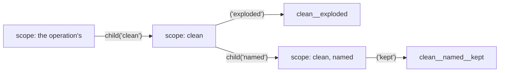
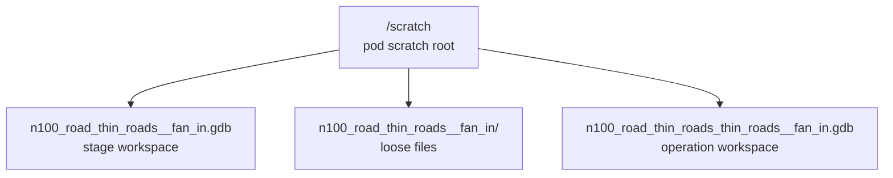
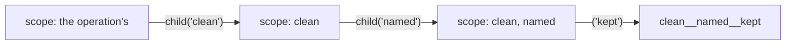
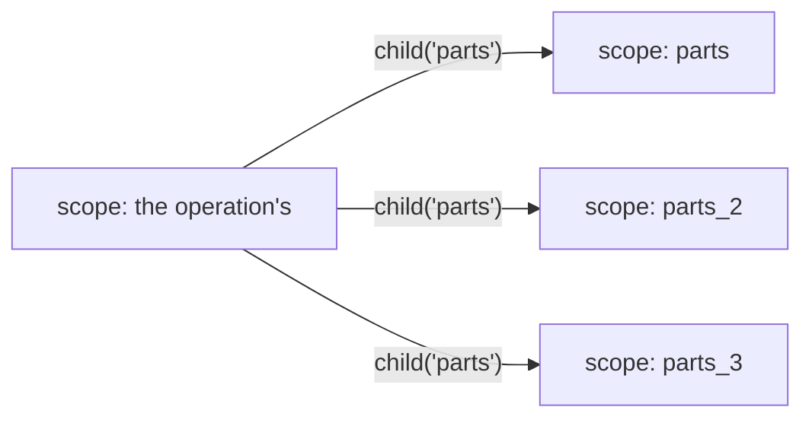

# Scratch space in operations

**Status:** CURRENT, except the paragraphs marked TARGET: the stage entry point does not yet
bind a scope to each call; until it does, a scope comes from
`ScratchFileManager.scope_for(call)`.

Every code sample on this page is run by
[`tests/unit/docs/test_scratch_user_guide.py`](../../tests/unit/docs/test_scratch_user_guide.py)
against the in-memory fakes, and every layer name, manifest entry and error message shown
is asserted by it. The samples are the text of
[`tests/unit/docs/scratch_samples.py`](../../tests/unit/docs/scratch_samples.py), so an
edit to the page or to the code it documents fails that test, naming the other side.

## Summary

Internal scratch is what an operation creates for itself and reads back before it is done:
the exploded copy, the selection, the table of counts. An operation receives a
`ScratchScope`, named `scratch` in its signature, and asks it for a handle with
`scratch("leaf")`. The scope names the handle by its trail and leaf, the scratch manager
gives it a path in the operation's own workspace, and the port that writes it creates the
dataset. A helper that names intermediates of its own gets one level down with
`scratch.child("label")`, and never learns where it sits. What another operation reads is
not scratch: it is a declared handle on the stage's handle class, named once, living in the
stage workspace.

## Illustration

One operation, one helper one level down, and the layer names in the operation workspace.
The trail is the prefix; the leaf is the last part; two underscores join them
([02-runtime §4.2](../refactor/02-runtime.md#42-scratch-workspaces-and-naming)).



The pod scratch root for the stage `n100/road/thin_roads` on its fan-in pod with one call,
`thin_roads`. The stage workspace holds the declared handles, one operation workspace per
call holds that call's scratch, and the loose-files directory beside the stage workspace
holds what a workspace cannot: layer files, CSV, logs.



<!-- names: layout -->
```text
/scratch/n100_road_thin_roads__fan_in.gdb
/scratch/n100_road_thin_roads__fan_in
/scratch/n100_road_thin_roads_thin_roads__fan_in.gdb
```

## When to use what

- **`scratch("leaf")`** for an intermediate the operation itself writes and reads. Nothing
  outside the operation ever sees it.
- **A handle created in the caller and passed to a helper** when the caller reads the result
  afterwards. The caller names it; the helper takes it as `output` and needs no scope.
- **`scratch.child("label")`** for each helper, or each group of steps, that names
  intermediates of its own. The helper receives a scope exactly as an operation does.
- **`scratch.child("label", tag="...")`** when the same helper is called more than once and
  the repetition has a meaning worth reading in a name: a pass, a variant, a side.
- **The automatic `_2`** when it does not. A repeated label gets `_2`, `_3` and so on; the
  first occurrence stays unnumbered, so adding a second call later renames nothing.
- **A declared handle**, a class attribute made with `handle()`, for every stage input,
  every stage output and anything one operation writes for another to read. Declared
  handles are not scratch and carry no trail.

## Usage notes

- A label, a tag and a leaf are letters, digits and single underscores:
  `[A-Za-z0-9]+(?:_[A-Za-z0-9]+)*`. Two underscores in a row are refused, because two
  underscores separate the parts of a layer name. Anything else, a hyphen, a dot, a space,
  a Norwegian letter, is refused with a `ValueError` at the call, never rewritten.
- A repeated leaf in one scope raises. `scratch("parts")` twice at the same point of the
  trail would be two equal handles naming the same file; the second call is the mistake,
  and the error says to use `scratch.child(...)` where two tools need the same leaf.
- A repeated label is indexed: `child("parts")`, `child("parts")`, `child("parts")` give
  `parts`, `parts_2`, `parts_3`. A tag is part of the label: `child("parts", tag="2")` is
  the segment `parts_2`, and a later plain `child("parts")` repeat takes the next free
  index.
- Names are unique without regard to case. The engine treats `Parts` and `parts` as one
  name and, with overwrite on, the second silently replaces the first, so the manager keys
  every path on its casefolded form and raises on the second.
- A rendered layer name is used as it is up to 160 characters. A longer one is shortened by
  whole labels, never cut inside a label: the leaf is always kept, labels are kept from the
  leaf backwards while they fit, the first label is kept if there is room, and a twelve-digit
  window of the digest of the full name marks where labels were dropped. When a name is
  shortened, the leaf may be at most 145 characters; a longer leaf raises, since its length
  is the author's choice.
- Workspace names are never shortened. A workspace name over 110 characters raises in the
  manager's constructor, before any operation runs, so a long stage or operation name fails
  the pod at once.
- A scope is bound to one call. Take it as a parameter and pass it on with `child`; never
  keep it on an object that outlives the call, and never hand the same scope to two
  helpers that each name their own intermediates.
- Never build a scratch path by hand, and never construct a `ScratchScope` in an operation.
  The runtime injects it; a test gets one from a manager.

## Reference

### `scratch(name, data_type=DataType.FEATURE_CLASS)`

Creates one internal scratch handle at this point in the trail.

- `name` (`str`): the leaf. Letters, digits and single underscores. It becomes the last
  part of the layer name, and the handle's name is the trail and the leaf joined.
- `data_type` (`DataType`, default `FEATURE_CLASS`): the kind of dataset the handle names.
  A port that writes a different kind to it raises, so say `DataType.TABLE` where a table is
  meant.
- Returns a `ScratchHandle` whose `path` is set: the operation workspace joined with the
  rendered layer name. Pass it to ports as `input` or `output`. The handle's `name` is the
  trail and the leaf joined with `/`, which is not a layer-name character, so a handle's
  name is never mistaken for the layer it renders to; the layer name joins them with `__`.

<!-- sample: handle_name -->
```python
def handle_name() -> ScratchHandle:
    return (
        fan_in_pod(MemoryStore()).scope_for(CALL).child("clean").child("named")("kept")
    )
```

<!-- handle: handle_name -->
```text
name: clean/named/kept
layer: clean__named__kept
```

### `scratch.child(label, tag=None)`

Descends one level, for a helper or a group of steps that names its own intermediates.

- `label` (`str`): the segment the helper's names will carry. Letters, digits and single
  underscores.
- `tag` (`str | None`, default `None`): joined to the label with one underscore when
  given, so `child("parts", tag="reranked")` is the segment `parts_reranked`.
- Returns a new `ScratchScope` with the segment appended to the trail. A segment already
  issued in this scope takes the lowest free index, `_2`, `_3` and so on.

## Code samples

Every sample is complete: with the imports and the setup below it runs as printed. The
imports hold what the samples and their test use.

<!-- sample: imports -->
```python
from ag.adapters.fakes.memory.cartographic_ops import MemoryCartographicOps
from ag.adapters.fakes.memory.geometry_ops import MemoryGeometryOps
from ag.adapters.fakes.memory.store import MemoryStore
from ag.adapters.fakes.memory.table_ops import MemoryTableOps
from ag.core.errors import InjectionError
from ag.core.handles import (
    INJECTED,
    Handles,
    In,
    Out,
    ScratchHandle,
    ScratchScope,
    handle,
)
from ag.core.operations import operation
from ag.core.types import DataType, PodRole
from ag.ports import NOT_INJECTED, Attr, Comparison, Toolbox
from ag.staging.errors import StagingError, WorkspaceError
from ag.staging.scratch import ScratchFileManager
from tests.support.cases import multilines
```

The setup every sample shares: the stage and call the samples spell, the one predicate they
select with, the stage's declared handles, a toolbox over the in-memory fakes, and the
manager a fan-in pod of the stage would hold. `GraphOps` and `CartographicOps` have no
members yet, so any object serves as the graph fake.

<!-- sample: setup -->
```python
STAGE = "n100/road/thin_roads"
"""The stage's qualified name; the runtime computes it, the samples spell it."""

CALL = f"{STAGE}:thin_roads"
"""The identity of the one operation call the sample pod runs."""

NAMED = Attr.cmp("name", Comparison.NE, "")
"""The one predicate every sample selects with: the roads that carry a name."""


class Roads(Handles):
    """The stage's declared handles: what its operations read and write."""

    source = handle()
    thinned = handle()


class NoGraph:
    """`GraphOps` has no members yet, so any object serves as its fake."""


def memory_toolbox(store: MemoryStore) -> Toolbox:
    """Every port over one in-memory store."""
    return Toolbox(
        geometry=MemoryGeometryOps(store=store),
        table=MemoryTableOps(store=store),
        cartographic=MemoryCartographicOps(store=store),
        graph=NoGraph(),
    )


def fan_in_pod(
    store: MemoryStore, *, calls: tuple[str, ...] = (CALL,)
) -> ScratchFileManager:
    """The manager the stage's fan-in pod would hold, over the same store."""
    return ScratchFileManager(
        root="/scratch",
        stage=STAGE,
        calls=calls,
        role=PodRole.FAN_IN,
        table=MemoryTableOps(store=store),
    )
```

### A minimal operation

*TARGET: the runtime will inject `scratch`; the stage entry point does not yet bind a scope
to each call, so the guide's test calls the body with a scope from `scope_for(call)`.*

One intermediate, written by one port and read by the next.

<!-- sample: minimal -->
```python
@operation
def thin_roads(
    *,
    source: In,
    output: Out,
    tb: Toolbox = NOT_INJECTED,
    scratch: ScratchScope = INJECTED,
) -> None:
    """Keeps the named roads, one row per part."""
    singlepart = scratch("singlepart")
    tb.geometry.explode_multipart(input=source, output=singlepart)
    tb.geometry.select(input=singlepart, where=NAMED, output=output)
```

<!-- names: minimal -->
```text
singlepart
```

### A helper with `child`

*TARGET: as above, the operation's `scratch` is injected by the runtime.*

The helper names its own intermediate. It receives a scope one level down and never learns
its trail; the operation decides the label.

<!-- sample: helper_with_child -->
```python
def _parts(*, roads: In, output: Out, tb: Toolbox, scratch: ScratchScope) -> None:
    """The named roads of `roads`, one row per part, written to `output`."""
    exploded = scratch("exploded")
    tb.geometry.explode_multipart(input=roads, output=exploded)
    tb.geometry.select(input=exploded, where=NAMED, output=output)


@operation
def thin_roads_with_helper(
    *,
    source: In,
    output: Out,
    tb: Toolbox = NOT_INJECTED,
    scratch: ScratchScope = INJECTED,
) -> None:
    _parts(roads=source, output=output, tb=tb, scratch=scratch.child("parts"))
```

<!-- names: helper_with_child -->
```text
parts__exploded
```

### The same helper twice: the automatic suffix

*TARGET: as above.*

The first call's names carry `parts`, the second's `parts_2`. Neither call knows about the
other, and adding the second renamed nothing in the first.

<!-- sample: helper_twice -->
```python
@operation
def thin_roads_twice(
    *,
    source: In,
    output: Out,
    tb: Toolbox = NOT_INJECTED,
    scratch: ScratchScope = INJECTED,
) -> None:
    first_pass = scratch("first_pass")
    _parts(roads=source, output=first_pass, tb=tb, scratch=scratch.child("parts"))
    _parts(roads=first_pass, output=output, tb=tb, scratch=scratch.child("parts"))
```

<!-- names: helper_twice -->
```text
first_pass
parts__exploded
parts_2__exploded
```

### The same helper twice: a tag

*TARGET: as above.*

When the repetition has a meaning, say it. The tag joins the label with one underscore.

<!-- sample: helper_tagged -->
```python
@operation
def thin_roads_tagged(
    *,
    source: In,
    output: Out,
    tb: Toolbox = NOT_INJECTED,
    scratch: ScratchScope = INJECTED,
) -> None:
    first_pass = scratch("first_pass")
    _parts(roads=source, output=first_pass, tb=tb, scratch=scratch.child("parts"))
    _parts(
        roads=first_pass,
        output=output,
        tb=tb,
        scratch=scratch.child("parts", tag="reranked"),
    )
```

<!-- names: helper_tagged -->
```text
first_pass
parts__exploded
parts_reranked__exploded
```

### Outputs named by the caller

*TARGET: as above.*

A helper that names nothing of its own takes no scope. The caller creates the handle, hands
it over as `output`, and reads it afterwards.

<!-- sample: caller_names_outputs -->
```python
def _exploded(*, roads: In, output: Out, tb: Toolbox) -> None:
    """One row per part. Names nothing of its own, so it takes no scope."""
    tb.geometry.explode_multipart(input=roads, output=output)


@operation
def thin_roads_reading_back(
    *,
    source: In,
    output: Out,
    tb: Toolbox = NOT_INJECTED,
    scratch: ScratchScope = INJECTED,
) -> None:
    parts = scratch("parts")
    _exploded(roads=source, output=parts, tb=tb)
    tb.geometry.select(input=parts, where=NAMED, output=output)
```

<!-- names: caller_names_outputs -->
```text
parts
```

### A loop

*TARGET: as above.*

An f-string leaf for what the loop body itself writes, and one `child` per iteration, tagged
with the iteration, for the helper it calls. The leaf form is right when the body is the
only thing that names the layer; the child form is right when a helper names several.

<!-- sample: loop -->
```python
@operation
def thin_roads_in_sweeps(
    *,
    source: In,
    output: Out,
    tb: Toolbox = NOT_INJECTED,
    scratch: ScratchScope = INJECTED,
) -> None:
    for letter in ("a", "b", "e"):
        named = scratch(f"named_{letter}")
        tb.geometry.select(
            input=source, where=Attr.cmp("name", Comparison.EQ, letter), output=named
        )
        _parts(
            roads=named,
            output=scratch(f"parts_{letter}"),
            tb=tb,
            scratch=scratch.child("sweep", tag=letter),
        )
    tb.geometry.explode_multipart(input=source, output=output)
```

<!-- names: loop -->
```text
named_a
parts_a
sweep_a__exploded
named_b
parts_b
sweep_b__exploded
named_e
parts_e
sweep_e__exploded
```

### Nested helpers

*TARGET: as above.*

Each level adds one segment. The inner helper's names carry both labels, and neither
helper wrote either.

<!-- sample: nested -->
```python
def _named(*, roads: In, output: Out, tb: Toolbox, scratch: ScratchScope) -> None:
    kept = scratch("kept")
    tb.geometry.select(input=roads, where=NAMED, output=kept)
    tb.geometry.explode_multipart(input=kept, output=output)


def _clean(*, roads: In, output: Out, tb: Toolbox, scratch: ScratchScope) -> None:
    """Explodes, then hands the parts to `_named` one level down."""
    exploded = scratch("exploded")
    tb.geometry.explode_multipart(input=roads, output=exploded)
    _named(roads=exploded, output=output, tb=tb, scratch=scratch.child("named"))


@operation
def thin_roads_nested(
    *,
    source: In,
    output: Out,
    tb: Toolbox = NOT_INJECTED,
    scratch: ScratchScope = INJECTED,
) -> None:
    _clean(roads=source, output=output, tb=tb, scratch=scratch.child("clean"))
```

<!-- names: nested -->
```text
clean__exploded
clean__named__kept
```

### Testing a helper

CURRENT. A helper is tested with a scope from a manager over `MemoryTableOps`, the input
seeded into the same store, and the output a materialised declared handle. The in-memory
store writes without a created workspace, so the test never touches the disk;
`create_workspaces` is the runtime's step. The manifest says what the helper named.

<!-- sample: testing -->
```python
def test_parts_explodes_into_its_own_scratch() -> None:
    store = MemoryStore()
    tb = memory_toolbox(store)
    pod = fan_in_pod(store)
    source = pod.handle(Roads.source)
    case = multilines()
    store.write(source, schema=case.schema, rows=case.rows)

    _parts(
        roads=source,
        output=pod.handle(Roads.thinned),
        tb=tb,
        scratch=pod.scope_for(CALL),
    )

    assert tb.table.exists(input=pod.handle(Roads.thinned))
    assert list(pod.manifest()) == [
        "/scratch/n100_road_thin_roads_thin_roads__fan_in.gdb/exploded"
    ]
```

## Naming examples

Each case issues handles from a scope and shows the layer names as the manifest lists them.
The names are what a reader sees in the operation workspace of a scratch dump.

### Short and unchanged

<!-- sample: case_unchanged -->
```python
def case_unchanged() -> ScratchFileManager:
    pod = fan_in_pod(MemoryStore())
    pod.scope_for(CALL)("singlepart")
    return pod
```

<!-- names: case_unchanged -->
```text
singlepart
```

### Nested



<!-- sample: case_nested -->
```python
def case_nested() -> ScratchFileManager:
    pod = fan_in_pod(MemoryStore())
    pod.scope_for(CALL).child("clean").child("named")("kept")
    return pod
```

<!-- names: case_nested -->
```text
clean__named__kept
```

### The automatic suffix



<!-- sample: case_suffix -->
```python
def case_suffix() -> ScratchFileManager:
    pod = fan_in_pod(MemoryStore())
    scratch = pod.scope_for(CALL)
    scratch.child("parts")("exploded")
    scratch.child("parts")("exploded")
    scratch.child("parts")("exploded")
    return pod
```

<!-- names: case_suffix -->
```text
parts__exploded
parts_2__exploded
parts_3__exploded
```

### A tag

A tag is part of the label. `child("parts", tag="2")` is the segment `parts_2`, the same
segment a plain repeat of `child("parts")` would take; whichever comes first takes it and
the other moves to the next free index.

<!-- sample: case_tagged -->
```python
def case_tagged() -> ScratchFileManager:
    pod = fan_in_pod(MemoryStore())
    scratch = pod.scope_for(CALL)
    scratch.child("parts")("exploded")
    scratch.child("parts", tag="reranked")("exploded")
    scratch.child("parts", tag="2")("exploded")
    return pod
```

<!-- names: case_tagged -->
```text
parts__exploded
parts_reranked__exploded
parts_2__exploded
```

### A table

The kind is the handle's, declared where it is created. The name is rendered the same way.

<!-- sample: case_table -->
```python
def case_table() -> ScratchFileManager:
    pod = fan_in_pod(MemoryStore())
    counts = pod.scope_for(CALL)("counts", DataType.TABLE)
    assert counts.data_type is DataType.TABLE
    return pod
```

<!-- names: case_table -->
```text
counts
```

### Shortened

Two long labels of a helper chain, then three leaves of growing length under the same
trail. With the short leaf the last label and the first label fit and the middle one is
dropped; with the medium leaf the first label goes too; with the long leaf the last label
is dropped and the short first label comes back, because labels are kept from the leaf
backwards while they fit and the first label whenever there is room. The mark `t` plus
twelve hex digits is a window of the SHA-256 digest of the casefolded full name, so the
three names carry three different marks.

<!-- sample: long_labels -->
```python
AREAS = "attach_the_administrative_area_attributes_to_every_road_segment_of_the_source"
TOPOLOGY = "build_the_topology_over_the_dissolved_network_with_degrees_and_components"
"""Two labels of a helper chain whose names were never shortened by their authors."""
```

<!-- sample: case_shortened -->
```python
def case_shortened() -> ScratchFileManager:
    pod = fan_in_pod(MemoryStore())
    scratch = pod.scope_for(CALL).child("clean").child(AREAS).child(TOPOLOGY)
    scratch("nodes")
    scratch("nodes_with_their_degree_and_component_recorded_for_the_second_pass")
    scratch(
        "nodes_with_their_degree_their_component_the_rank_of_the_longest_road_"
        "touching_them_and_the_sweep_that_recorded_them"
    )
    return pod
```

<!-- names: case_shortened -->
```text
clean__t83ccdf818e30__build_the_topology_over_the_dissolved_network_with_degrees_and_components__nodes
tbfb4d71d2c6e__build_the_topology_over_the_dissolved_network_with_degrees_and_components__nodes_with_their_degree_and_component_recorded_for_the_second_pass
clean__tc326f709eb5d__nodes_with_their_degree_their_component_the_rank_of_the_longest_road_touching_them_and_the_sweep_that_recorded_them
```

The manifest reads each back to its call, trail, leaf and window:

<!-- manifest: case_shortened -->
```text
Issued(path='/scratch/n100_road_thin_roads_thin_roads__fan_in.gdb/clean__t83ccdf818e30__build_the_topology_over_the_dissolved_network_with_degrees_and_components__nodes', call='n100/road/thin_roads:thin_roads', trail=('clean', 'attach_the_administrative_area_attributes_to_every_road_segment_of_the_source', 'build_the_topology_over_the_dissolved_network_with_degrees_and_components'), leaf='nodes', window=0)
Issued(path='/scratch/n100_road_thin_roads_thin_roads__fan_in.gdb/tbfb4d71d2c6e__build_the_topology_over_the_dissolved_network_with_degrees_and_components__nodes_with_their_degree_and_component_recorded_for_the_second_pass', call='n100/road/thin_roads:thin_roads', trail=('clean', 'attach_the_administrative_area_attributes_to_every_road_segment_of_the_source', 'build_the_topology_over_the_dissolved_network_with_degrees_and_components'), leaf='nodes_with_their_degree_and_component_recorded_for_the_second_pass', window=0)
Issued(path='/scratch/n100_road_thin_roads_thin_roads__fan_in.gdb/clean__tc326f709eb5d__nodes_with_their_degree_their_component_the_rank_of_the_longest_road_touching_them_and_the_sweep_that_recorded_them', call='n100/road/thin_roads:thin_roads', trail=('clean', 'attach_the_administrative_area_attributes_to_every_road_segment_of_the_source', 'build_the_topology_over_the_dissolved_network_with_degrees_and_components'), leaf='nodes_with_their_degree_their_component_the_rank_of_the_longest_road_touching_them_and_the_sweep_that_recorded_them', window=0)
```

### Two trails apart only in a dropped label

Two trails that differ only in the label the shortening drops render the same kept parts.
Their digests differ, so their marks differ and the names are two. The real digest gives
two names the same twelve-digit window once in 16 to the 12th; when it happens, the manager
takes the next window of the digest and records it in the manifest. The sample forces the
collision with a stand-in digest, passed through the constructor's `digest` parameter.

<!-- sample: digest -->
```python
def windows_apart(full: str) -> str:
    """A digest that is the same for every name, with every window distinct, so every
    shortened name collides and the probe must move on. A stand-in, for the page, for
    the one name in 16 to the 12th that the real digest would give the same window."""
    return "".join(str(window) * 12 for window in range(5)).ljust(64, "f")


def probing_pod(store: MemoryStore) -> ScratchFileManager:
    return ScratchFileManager(
        root="/scratch",
        stage=STAGE,
        calls=(CALL,),
        role=PodRole.FAN_IN,
        table=MemoryTableOps(store=store),
        digest=windows_apart,
    )
```

<!-- sample: case_probe -->
```python
def case_probe() -> ScratchFileManager:
    pod = probing_pod(MemoryStore())
    scratch = pod.scope_for(CALL).child("clean")
    scratch.child(AREAS).child(TOPOLOGY)("nodes")
    scratch.child(AREAS + "_again").child(TOPOLOGY)("nodes")
    return pod
```

<!-- names: case_probe -->
```text
clean__t000000000000__build_the_topology_over_the_dissolved_network_with_degrees_and_components__nodes
clean__t111111111111__build_the_topology_over_the_dissolved_network_with_degrees_and_components__nodes
```

<!-- manifest: case_probe -->
```text
Issued(path='/scratch/n100_road_thin_roads_thin_roads__fan_in.gdb/clean__t000000000000__build_the_topology_over_the_dissolved_network_with_degrees_and_components__nodes', call='n100/road/thin_roads:thin_roads', trail=('clean', 'attach_the_administrative_area_attributes_to_every_road_segment_of_the_source', 'build_the_topology_over_the_dissolved_network_with_degrees_and_components'), leaf='nodes', window=0)
Issued(path='/scratch/n100_road_thin_roads_thin_roads__fan_in.gdb/clean__t111111111111__build_the_topology_over_the_dissolved_network_with_degrees_and_components__nodes', call='n100/road/thin_roads:thin_roads', trail=('clean', 'attach_the_administrative_area_attributes_to_every_road_segment_of_the_source_again', 'build_the_topology_over_the_dissolved_network_with_degrees_and_components'), leaf='nodes', window=1)
```

### Two names apart only in case

Raise; see the repeated leaf under errors the manager raises for a scratch call. `parts`
and `Parts` are one name to the engine.

## Reading names back

`manager.manifest()` maps every issued path to an entry holding `call`, `trail`, `leaf` and
`window`, and `entry.identity` is `(call, *trail, leaf)`. In a test, look the path of a
handle up to assert what a helper named; while debugging, map a layer seen in an operation
workspace to the code that made it, shortened or not. The window says which twelve-digit
slice of the digest the name carries; `0` is the first and the usual one.

## Best practice and pitfalls

- Short, meaningful labels: the helper's purpose in two or three words, not its whole
  signature. A label is read in every name below it.
- Leaves that say what the layer holds: `singlepart`, `named_a`, `kept`. A leaf is read
  beside the other leaves of the same scope.
- Lean stage and operation function names. A workspace name is the rendered stage or call
  identity and the pod stem, and over 110 characters it raises before any operation runs.
- No scope on an object. A scope is a live allocator bound to one call; stored, it outlives
  the call and names the next call's scratch into the wrong workspace.
- The manager is never passed to an operation. An operation sees a scope and a toolbox and
  nothing of workspaces or paths.

## Limits

Each limit is declared once in `src/ag/staging/workspace.py` and measured, not assumed
([02-runtime §4.2](../refactor/02-runtime.md#42-scratch-workspaces-and-naming)).

- 160 characters for a layer name: the file geodatabase's own limit for a feature class and
  a table, measured in the engine; 161 is refused with the engine's error.
- 145 characters for a leaf beside the digest: 160 less the mark of 13 characters and one
  separator of two.
- 110 characters for a workspace name, suffix included: a geodatabase's longest internal
  file name is 48 characters, and the path to it must fit a Windows file path of 259 under
  a root allowance of 100.
- 259 and 247 characters for a Windows file path and folder path: the margins a person's
  tools stop at when long paths are not enabled, measured on a Windows machine. The engine
  itself writes past them; the limit protects the copy and the extraction.
- 100 characters of root allowance: the room reserved for the path above the pod scratch
  root, so a dump copied under a short folder opens.

## Errors

Each error with the code that raises it, the whole message as the fakes render it, and
the fix. The snippets use the setup from the code samples and, for the digest, the stand-in
from the naming examples.

### Errors the scope raises

Raised at the call, in the operation or helper that made it.

- `ValueError`: a label, tag or leaf that cannot be part of a layer name. Fix: spell it with
  letters, digits and single underscores.

<!-- sample: error_bad_segment -->
```python
def error_bad_segment() -> None:
    fan_in_pod(MemoryStore()).scope_for(CALL)("road-parts")
```

<!-- error: error_bad_segment -->
```text
scope leaf 'road-parts' must be letters, digits and single underscores; it becomes part of a layer name.
```

- `InjectionError`: the scope was never bound. The operation was called directly with its
  default, or something constructed a scope by hand. Fix: let the runtime inject it; in a
  test, take a scope from a manager, as the testing sample above does.

<!-- sample: error_unbound -->
```python
def error_unbound() -> None:
    INJECTED("singlepart")
```

<!-- error: error_unbound -->
```text
scratch('singlepart') was called on a scope the runtime never bound. The stage entry point must hand its own scope to any operation whose signature declares `scratch: ScratchScope = INJECTED`.
```

### Errors the manager raises for a scratch call

`WorkspaceError`, raised at the `scratch(...)` call that asked for the name.

- A repeated leaf in one scope, in any case. Fix: give the second handle its own leaf, or
  give the helper a `child`.

<!-- sample: error_repeated_leaf -->
```python
def error_repeated_leaf() -> None:
    scratch = fan_in_pod(MemoryStore()).scope_for(CALL)
    scratch("parts")
    scratch("Parts")
```

<!-- error: error_repeated_leaf -->
```text
scratch path '/scratch/n100_road_thin_roads_thin_roads__fan_in.gdb/Parts' was already issued in this pod for ('n100/road/thin_roads:thin_roads', 'parts'); a repeated leaf within one scope is a mistake, and the engine treats two names differing only in case as one. Use scratch.child(...) where two tools need the same leaf.
```

- A leaf too long to sit beside the digest when the name is shortened. Fix: shorten the
  leaf; it is the author's to choose.

<!-- sample: error_leaf_too_long -->
```python
def error_leaf_too_long() -> None:
    fan_in_pod(MemoryStore()).scope_for(CALL).child("clean")("x" * 154)
```

<!-- error: error_leaf_too_long -->
```text
leaf 'xxxxxxxxxxxxxxxxxxxxxxxxxxxxxxxxxxxxxxxxxxxxxxxxxxxxxxxxxxxxxxxxxxxxxxxxxxxxxxxxxxxxxxxxxxxxxxxxxxxxxxxxxxxxxxxxxxxxxxxxxxxxxxxxxxxxxxxxxxxxxxxxxxxxxxxxxx' is 154 characters; beside the digest of its trail the geodatabase's limit of 160 leaves 145. A leaf's length is the author's choice: shorten it.
```

- Every window of the digest taken by other trails whose shortened names agree. Fix:
  shorten a label so the trails differ in a kept part. In practice this needs digests that
  collide; the sample forces it with the stand-in digest from the naming examples.

<!-- sample: error_every_window_taken -->
```python
def error_every_window_taken() -> None:
    scratch = probing_pod(MemoryStore()).scope_for(CALL).child("clean")
    for suffix in ("", "_2", "_3", "_4", "_5", "_6"):
        scratch.child(AREAS + suffix).child(TOPOLOGY)("nodes")
```

<!-- error: error_every_window_taken -->
```text
every one of the 5 shortened names for ('n100/road/thin_roads:thin_roads', 'clean', 'attach_the_administrative_area_attributes_to_every_road_segment_of_the_source_6', 'build_the_topology_over_the_dissolved_network_with_degrees_and_components', 'nodes') is taken by another trail in this pod.
```

### Errors the manager raises for a declared handle

`WorkspaceError`, raised when the runtime materialises the stage's declared handles.

- A declared name over 160 characters. It has no trail to drop, so it cannot be shortened.
  Fix: rename the class attribute.

<!-- sample: error_declared_over_limit -->
```python
def error_declared_over_limit() -> None:
    fan_in_pod(MemoryStore()).handle(
        ScratchHandle(name="x" * 161, namespace="guide.Roads")
    )
```

<!-- error: error_declared_over_limit -->
```text
layer name 'xxxxxxxxxxxxxxxxxxxxxxxxxxxxxxxxxxxxxxxxxxxxxxxxxxxxxxxxxxxxxxxxxxxxxxxxxxxxxxxxxxxxxxxxxxxxxxxxxxxxxxxxxxxxxxxxxxxxxxxxxxxxxxxxxxxxxxxxxxxxxxxxxxxxxxxxxxxxxxxxx' is 161 characters, over the geodatabase's 160. A declared handle's name has no trail to shorten: rename it.
```

- A declared name that is not ASCII letters, digits and underscores starting with a letter
  or underscore. Fix: rename the class attribute; `veier_ae` where `veier_æ` was meant.

<!-- sample: error_illegal_declared -->
```python
def error_illegal_declared() -> None:
    fan_in_pod(MemoryStore()).handle(
        ScratchHandle(name="veier_æ", namespace="guide.Roads")
    )
```

<!-- error: error_illegal_declared -->
```text
name 'veier_æ' is not ASCII letters, digits and underscores starting with a letter or underscore, which every workspace, layer and loose file needs to open on Linux and on Windows.
```

- Two declared handles whose names differ only in case, in one or two handle classes. Fix:
  rename one.

<!-- sample: error_declared_case -->
```python
class Lower(Handles):
    roads = handle()


class Upper(Handles):
    Roads = handle()


def error_declared_case() -> None:
    pod = fan_in_pod(MemoryStore())
    pod.handle(Lower.roads)
    pod.handle(Upper.Roads)
```

<!-- error: error_declared_case -->
```text
ScratchHandle(tests.unit.docs.scratch_samples.Upper.Roads) would be at '/scratch/n100_road_thin_roads__fan_in.gdb/Roads', which ScratchHandle(tests.unit.docs.scratch_samples.Lower.roads) already holds without regard to case; the engine treats the two names as one.
```

### Errors the manager raises before any operation runs

Raised in the manager's constructor or when a scope is asked for. An author meets the first
two by naming; the rest are the runtime's wiring and are listed so the messages are
recognisable.

- `WorkspaceError`: a workspace name over 110 characters. The name is the rendered stage or
  call identity and the pod stem. Fix: a shorter stage name or operation function name.

<!-- sample: error_workspace_too_long -->
```python
def error_workspace_too_long() -> None:
    ScratchFileManager(
        root="/scratch",
        stage=STAGE + "/" + "x" * 100,
        calls=(),
        role=PodRole.FAN_IN,
        table=MemoryTableOps(store=MemoryStore()),
    )
```

<!-- error: error_workspace_too_long -->
```text
workspace name 'n100_road_thin_roads_xxxxxxxxxxxxxxxxxxxxxxxxxxxxxxxxxxxxxxxxxxxxxxxxxxxxxxxxxxxxxxxxxxxxxxxxxxxxxxxxxxxxxxxxxxxxxxxxxxxx__fan_in.gdb' is 133 characters, over 110: its internal files would not fit a Windows path of 259 under a root of 100.
```

- `WorkspaceError`: two identities, or the stage and a call, whose rendered workspace names
  agree without regard to case. Fix: rename one operation.

<!-- sample: error_alike -->
```python
def error_alike() -> None:
    fan_in_pod(MemoryStore(), calls=(CALL, f"{STAGE}:Thin_Roads"))
```

<!-- error: error_alike -->
```text
identities 'n100/road/thin_roads:thin_roads' and 'n100/road/thin_roads:Thin_Roads' both render to the workspace name 'n100_road_thin_roads_Thin_Roads' without regard to case.
```

- `StagingError`: a call identity the pod was not given.

<!-- sample: error_unknown_call -->
```python
def error_unknown_call() -> None:
    fan_in_pod(MemoryStore()).scope_for(f"{STAGE}:other")
```

<!-- error: error_unknown_call -->
```text
call identity 'n100/road/thin_roads:other' is not one this pod runs: ('n100/road/thin_roads:thin_roads',).
```

- `StagingError`: a call identity given twice.

<!-- sample: error_repeated_call -->
```python
def error_repeated_call() -> None:
    fan_in_pod(MemoryStore(), calls=(CALL, CALL))
```

<!-- error: error_repeated_call -->
```text
call identity 'n100/road/thin_roads:thin_roads' is given twice.
```

- `StagingError`: a partition index on a pod that is not a partition pod, or none on one
  that is.

<!-- sample: error_role_index -->
```python
def error_role_index() -> None:
    ScratchFileManager(
        root="/scratch",
        stage=STAGE,
        calls=(CALL,),
        role=PodRole.POD,
        table=MemoryTableOps(store=MemoryStore()),
    )
```

<!-- error: error_role_index -->
```text
role 'pod' with partition index None: only a 'pod' pod has an index, and every one does.
```

## Related topics

- [ADR-0020 OP-2](../decisions/0020-operations.md), injected parameters: `OP-D13` for the
  `INJECTED` default and `OP-D20` for passing `scratch` and `tb` the same way.
- [02-runtime §2.4](../refactor/02-runtime.md#24-operations), operations, and
  [§4.2](../refactor/02-runtime.md#42-scratch-workspaces-and-naming), scratch workspaces
  and naming.
- [Terminology](../terminology.md#1-terms): ScratchHandle, namespace, ScratchScope, trail,
  workspace, stage workspace, operation workspace, pod scratch root.
- The source: [`src/ag/core/handles.py`](../../src/ag/core/handles.py) for the scope,
  [`src/ag/staging/scratch.py`](../../src/ag/staging/scratch.py) for the manager,
  [`src/ag/staging/workspace.py`](../../src/ag/staging/workspace.py) for the names and
  limits.
- The test that keeps this page true:
  [`tests/unit/docs/test_scratch_user_guide.py`](../../tests/unit/docs/test_scratch_user_guide.py).

---
### Navigation

- [User guides](index.md)
- [Return to README](../../README.md)
