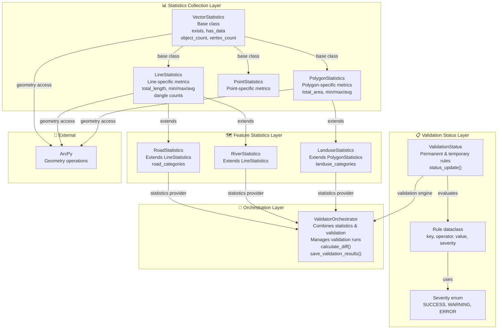
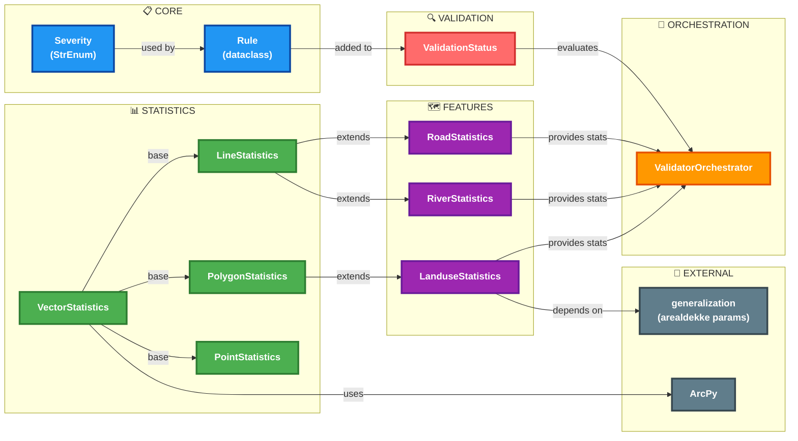
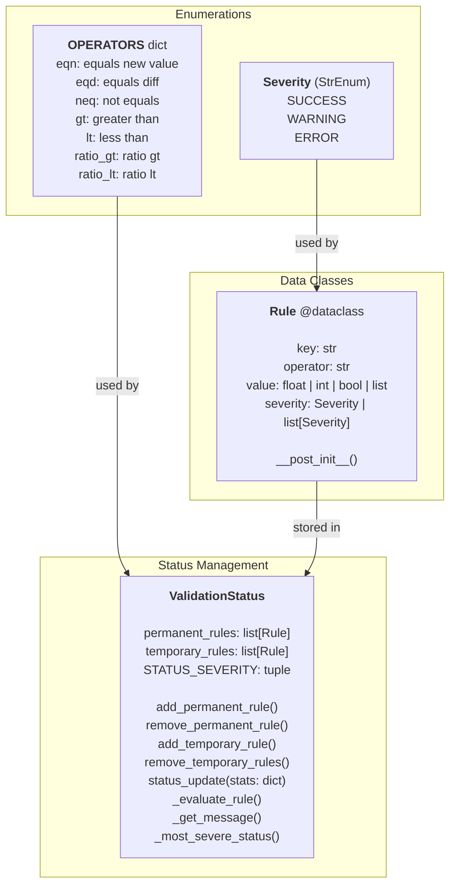
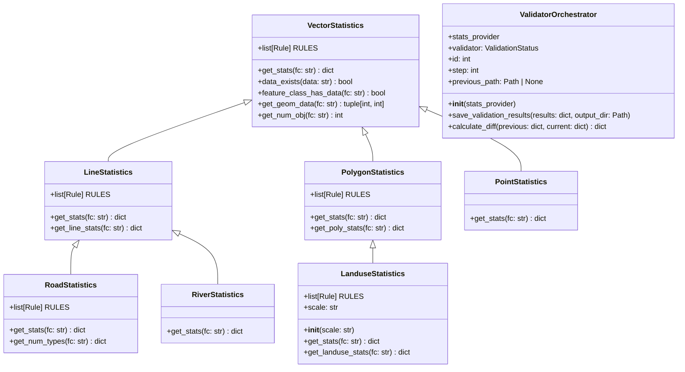
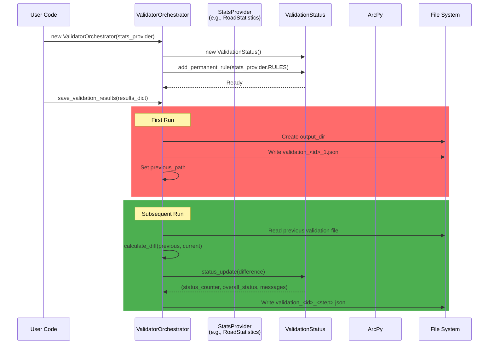
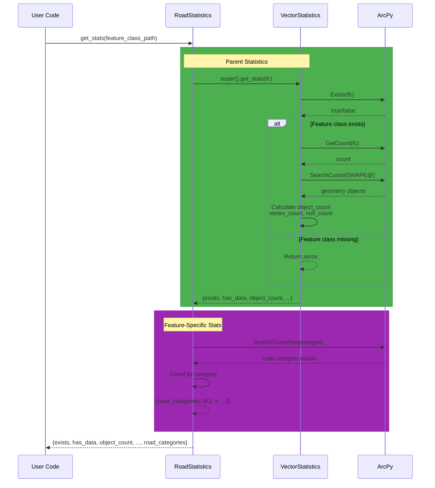
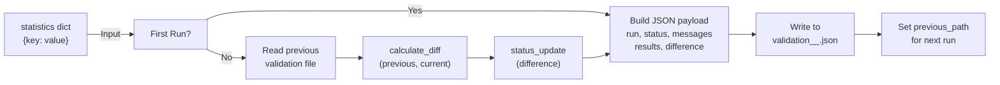

# Geometry Validation - Architecture & Module Dependencies

A comprehensive guide to the `geometry_validation` module structure, class hierarchies, statistics collection, and validation workflows.

---

## Table of Contents

1. [Overview](#overview)
2. [Architecture Layers](#architecture-layers)
3. [Module Dependencies](#module-dependencies)
4. [Class Hierarchy & Relationships](#class-hierarchy--relationships)
5. [Data Flow](#data-flow)
6. [Key Components](#key-components)
7. [Validation Rules & Status](#validation-rules--status)
8. [Usage Examples](#usage-examples)

---

## Overview

`geometry_validation` provides a framework for collecting, validating, and tracking statistics from geometric feature classes across different geometry types and feature categories. The module separates concerns into four key layers:

- **Validation Status Layer**: Rule-based status evaluation with severity levels (SUCCESS, WARNING, ERROR)
- **Statistics Collection Layer**: Geometry-type-specific statistics collectors (Vector, Line, Polygon, Point)
- **Feature Statistics Layer**: Feature-specific statistics providers (Road, River, Landuse)
- **Orchestration Layer**: Validation orchestrator that combines statistics and status checks

The framework supports incremental validation runs, automatic diff calculation between runs, and structured result serialization to JSON.

---

## Architecture Layers



---

## Module Dependencies

### Complete Dependency Graph



---

## Class Hierarchy & Relationships

### Validation Status Layer



### Statistics Collection Hierarchy



---

## Data Flow

### Statistics Collection Workflow



### Single Statistics Collection Example



### Validation Result Serialization



---

## Key Components

### 1. Validation Status (`validationStatus.py`)

Provides rule-based validation with configurable severity levels.

| Class/Enum | Responsibility |
|---|---|
| `Severity` | Enum: SUCCESS, WARNING, ERROR |
| `Rule` | Dataclass: key, operator, value, severity for a single validation rule |
| `ValidationStatus` | Manages permanent/temporary rules, evaluates rules against statistics |

**Operators** (in `OPERATORS` dict):
- `eqn`: new value equals threshold
- `eqd`: diff equals threshold
- `neq`: not equal
- `gt`: greater than
- `lt`: less than
- `ratio_gt`: absolute ratio > threshold
- `ratio_lt`: absolute ratio < threshold

**Design Principle**: Rules are immutable and reusable across runs and feature classes.

### 2. Data Type Statistics (`dataTypeStatistics.py`)

Base class for all geometry-type-specific statistics collectors.

| Class | Key Methods | Statistics Collected |
|---|---|---|
| `VectorStatistics` | `get_stats()`, `data_exists()`, `get_num_obj()`, `get_geom_data()` | exists, has_data, object_count, vertex_count, null_count |

**Responsibilities**:
- Check feature class existence via `arcpy.Exists()`
- Count objects and vertices using ArcPy cursors
- Track null/missing geometries
- Define base RULES for all geometry types

### 3. Geometry Type Statistics (`geometryTypeStatistics.py`)

Specialized statistics for specific geometry types; extend `VectorStatistics`.

| Class | Extends | Key Methods | Metrics |
|---|---|---|---|
| `LineStatistics` | VectorStatistics | `get_line_stats()` | total_length, min/max/avg_length, dangle counts |
| `PolygonStatistics` | VectorStatistics | `get_poly_stats()` | total_area, min/max/avg_area |
| `PointStatistics` | VectorStatistics | (none) | Inherits from parent |

**Key Details**:
- `LineStatistics`: Detects dangle lines (endpoints with only one connection point)
- `PolygonStatistics`: Computes area statistics from `SHAPE@AREA` field
- Both use ArcPy `SearchCursor` for geometry access

### 4. Feature Type Statistics (`featureTypeStatistics.py`)

Domain-specific statistics for real feature types; extend geometry-type classes.

| Class | Extends | Domain-Specific Metrics | Scale Support |
|---|---|---|---|
| `RoadStatistics` | LineStatistics | road_categories (vegkategori field) | N100, N250, etc. |
| `RiverStatistics` | LineStatistics | (inherited only) | All scales |
| `LanduseStatistics` | PolygonStatistics | landuse_categories (arealdekke field) | Scale-aware via `__init__` |

**Dependencies**:
- `RoadStatistics`: Accesses `vegkategori` field
- `LanduseStatistics`: Imports `get_min_area()` from `generalization.n10.arealdekke` for scale-specific rules

### 5. Validator Orchestrator (`validatorOrchestrator.py`)

Coordinates statistics collection, validation, and multi-run result tracking.

| Attribute | Type | Purpose |
|---|---|---|
| `stats_provider` | StatsProvider | Instance of any stats class (e.g., RoadStatistics) |
| `validator` | ValidationStatus | Rule evaluation engine |
| `id` | int | Unique validation run session ID (Unix timestamp) |
| `step` | int | Current run number within session |
| `previous_path` | Path \| None | Path to previous validation result file |

| Method | Purpose |
|---|---|
| `__init__(stats_provider)` | Initialize with rules from `stats_provider.RULES` |
| `save_validation_results(results, output_dir)` | Save validated results to JSON; compute diff if repeat run |
| `calculate_diff(previous, current)` | Compute new/diff/ratio for each metric |

**Output Format**: JSON with structure:
```json
{
  "run": 1,
  "status": "SUCCESS|WARNING|ERROR",
  "status_counts": {"SUCCESS": n, "WARNING": n, "ERROR": n},
  "messages": {"key": "message text"},
  "results": {...},
  "difference": {"key": {"new": val, "diff": val, "ratio": val}}
}
```

---

## Validation Rules & Status

### Rule Definition & Evaluation

A `Rule` specifies:
- **key**: metric name (e.g., "exists", "object_count", "road_categories")
- **operator**: how to evaluate (eqn, gt, lt, ratio_gt, etc.)
- **value**: threshold or expected value (scalar or list for multi-level)
- **severity**: outcome for each level (SUCCESS, WARNING, ERROR)

### Rule Examples

```python
# Must exist (ERROR if missing)
Rule("exists", "eqn", True, Severity.ERROR)

# Object count ratio with three severity levels
Rule("object_count", "ratio", [0.3, 0.6],
     [Severity.SUCCESS, Severity.WARNING, Severity.ERROR])
     # If ratio > 0.6: ERROR
     # If 0.3 < ratio <= 0.6: WARNING
     # If ratio <= 0.3: SUCCESS
```

### Multi-Run Validation

Each call to `save_validation_results()`:
1. Checks if a previous run exists
2. Computes `diff` and `ratio` for each metric
3. Applies rules to differences (not raw values)
4. Assigns severity based on rule operators
5. Returns overall status (highest severity wins)

---

## Usage Examples

### Example 1: Validate Road Features Across Runs

```python
from geometry_validation.featureTypeStatistics import RoadStatistics
from geometry_validation.validatorOrchestrator import ValidatorOrchestrator
from pathlib import Path

# Create orchestrator with road statistics provider
road_stats = RoadStatistics()
orchestrator = ValidatorOrchestrator(road_stats)

# First run
results_1 = {
    "elveg": road_stats.get_stats("/path/to/elveg_fc"),
    "sti": road_stats.get_stats("/path/to/sti_fc")
}
orchestrator.save_validation_results(results_1, Path("./validation"))

# Second run (will compute diffs and validate changes)
results_2 = {
    "elveg": road_stats.get_stats("/path/to/elveg_fc"),
    "sti": road_stats.get_stats("/path/to/sti_fc")
}
orchestrator.save_validation_results(results_2, Path("./validation"))
# Output: validation_<timestamp>_2.json with status based on changes
```

### Example 2: Add Custom Temporary Rules

```python
from geometry_validation.validationStatus import Rule, Severity, ValidationStatus
from geometry_validation.featureTypeStatistics import LanduseStatistics

# Create landuse validator with scale awareness
landuse_stats = LanduseStatistics(scale="N100")
orchestrator = ValidatorOrchestrator(landuse_stats)

# Add a one-time rule (removed after next status_update)
strict_rule = Rule("total_area", "lt", 0.1, Severity.ERROR)
orchestrator.validator.add_temporary_rule(strict_rule)

# Validate
results = {"landuse": landuse_stats.get_stats("/path/to/landuse_fc")}
orchestrator.save_validation_results(results)
# Temporary rules are cleared automatically

# Next call uses only permanent rules
orchestrator.save_validation_results(results)
```

### Example 3: Extend Statistics for Custom Feature Type

```python
from geometry_validation.geometryTypeStatistics import LineStatistics
from geometry_validation.validationStatus import Rule, Severity

class TrailStatistics(LineStatistics):
    RULES = [
        Rule("trail_surface_types", "ratio",
             [0.2, 0.5],
             [Severity.SUCCESS, Severity.WARNING, Severity.ERROR])
    ] + LineStatistics.RULES
    
    def get_stats(self, fc: str) -> dict:
        r1 = super().get_stats(fc)  # Line stats
        r2 = self._get_trail_stats(fc)  # Custom
        return {**r1, **r2}
    
    def _get_trail_stats(self, fc: str) -> dict:
        # Custom logic using arcpy.da.SearchCursor
        from collections import Counter
        field = "surface_type"
        counts = Counter()
        with arcpy.da.SearchCursor(fc, [field]) as cursor:
            counts = Counter(row[0] for row in cursor)
        return {"trail_surface_types": dict(counts)}
```

---

## See Also

- [data_orchestrator_2/ARCHITECTURE.md](../data_orchestrator_2/ARCHITECTURE.md) — Pipeline schema definitions
