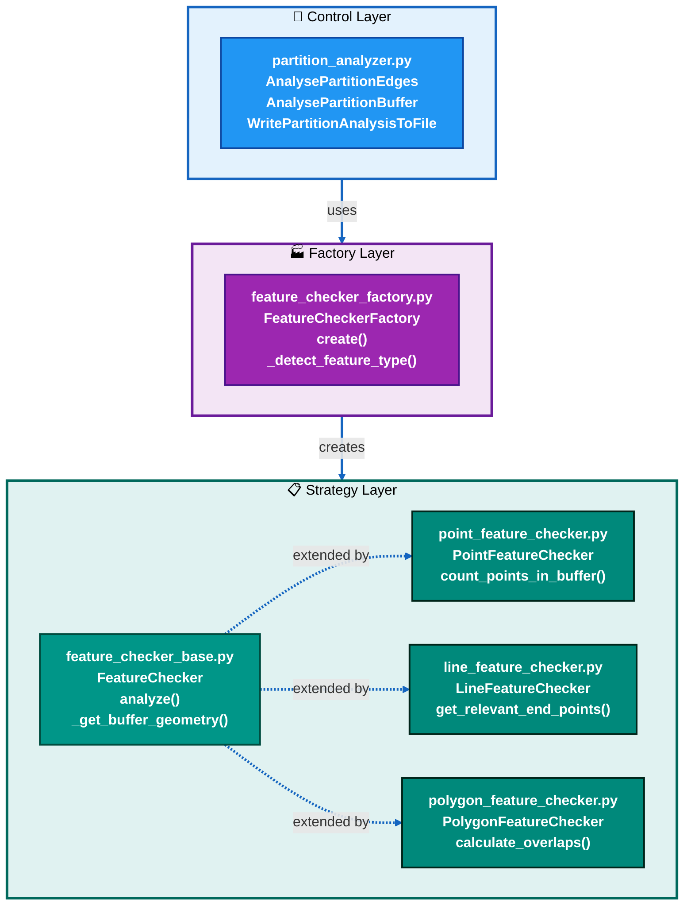
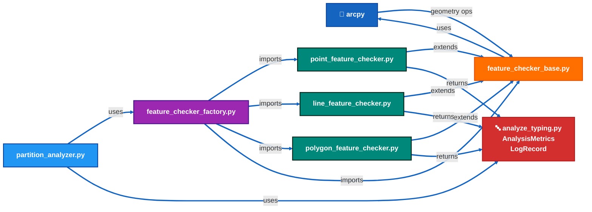
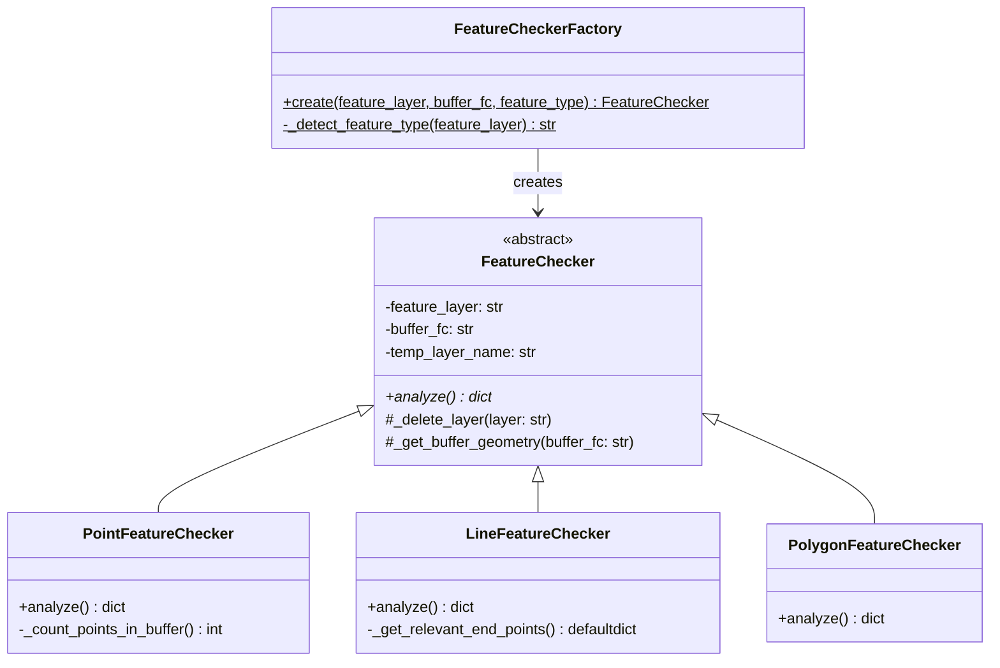
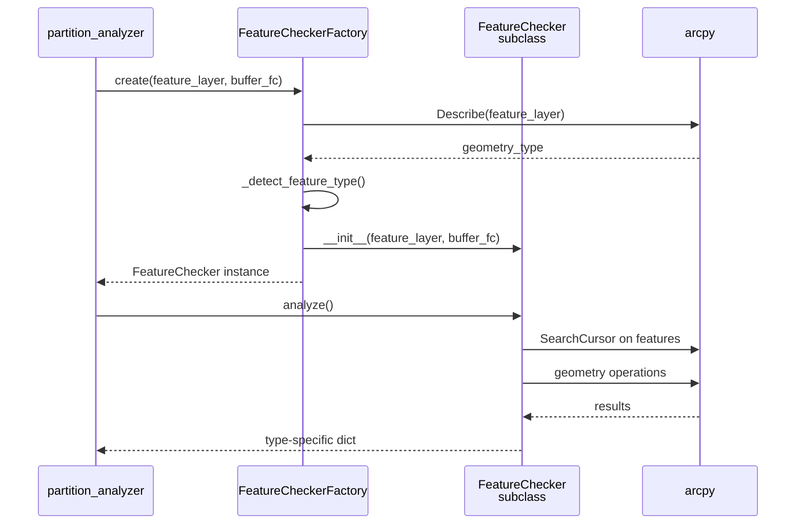

# Partition Validation - Architecture & Design

A lightweight architecture for feature type-specific partition boundary analysis using the Factory and Strategy patterns.

---

## Table of Contents

1. [Overview](#overview)
2. [Architecture Layers](#architecture-layers)
3. [Module Dependencies](#module-dependencies)
4. [Class Hierarchy](#class-hierarchy)
5. [Data Flow](#data-flow)
6. [Design Patterns](#design-patterns)

---

## Overview

`partition_validation` analyzes how features (points, lines, polygons) interact with partition boundaries. Each feature type has a dedicated analyzer that:
- Detects specific issues (dangles, overlaps, containment)
- Returns type-specific metrics
- Can be tested independently

The **FeatureCheckerFactory** automatically selects the correct analyzer based on the feature geometry type.

---

## Architecture Layers



---

## Module Dependencies



---

## Class Hierarchy



---

## Data Flow



---

## Design Patterns

### Factory Pattern
Encapsulates checker creation and auto-detection:
```python
checker = FeatureCheckerFactory.create(
    feature_layer=fc,
    buffer_fc=buffer
    # feature_type auto-detected
)
```

**Benefits:**
- Automatic type detection
- Central place to add new types
- Decouples creation from usage

### Strategy Pattern
Each checker implements a different analysis strategy:
```python
# Same interface, different algorithms
result_line = LineFeatureChecker(...).analyze()
result_point = PointFeatureChecker(...).analyze()
result_poly = PolygonFeatureChecker(...).analyze()
```

**Benefits:**
- Easy to test each strategy independently
- Easy to add new strategies
- Runtime algorithm selection

### Abstract Base Class
Defines the contract all strategies must follow:
```python
class FeatureChecker(ABC):
    @abstractmethod
    def analyze(self) -> dict[str, Any]:
        pass
```

**Benefits:**
- Enforces consistent interface
- Enables type hints
- Prevents incomplete implementations

---

## Feature Type Results

Each analyzer returns metrics specific to its feature type. All results conform to the flexible `AnalysisMetrics` TypedDict:

| Type | Metrics | Returns |
|------|---------|---------|
| **Line** | Dangle detection | `{"dangle_count": int, "feature_ids": list}` |
| **Point** | Containment count | `{"point_count": int}` |
| **Polygon** | Overlap analysis | `{"overlap_count": int, "overlap_area": float}` |

**Note:** `AnalysisMetrics` uses `total=False` to allow optional fields, enabling each feature type to return only its relevant metrics without requiring unused fields.

---

## Type System: `analyze_typing.py`

The module provides two TypedDict classes that define the structure of analysis data:

### AnalysisMetrics
```python
class AnalysisMetrics(TypedDict, total=False):
    # Point metrics
    point_count: int
    
    # Line metrics
    dangle_count: int
    feature_ids: list[Any]
    
    # Polygon metrics
    overlap_count: int
    overlap_area: float
```

**Key design:**
- `total=False` makes all fields optional
- Each feature checker returns only its relevant metrics
- Type-safe while remaining flexible
- Easy to add new metrics for new feature types

### LogRecord
```python
class LogRecord(TypedDict, total=False):
    caller: str
    timestamp: str
    buffer_distance: int
    input: dict[str, AnalysisMetrics]
    output: dict[str, AnalysisMetrics]
    difference: dict[str, int | float]
```

**Usage in partition_analyzer.py:**
- Wraps analysis results with metadata (caller, timestamp, buffer distance)
- Stores separate metrics for input and output feature classes
- Computed difference field for comparative analysis

---


**Steps:**
1. Create `my_type_feature_checker.py`
2. Extend `FeatureChecker`
3. Implement `analyze()` method
4. Add to `checker_map` in factory
5. Done! No modifications to existing code needed.

---

## Key Files

| File | Purpose | Lines |
|------|---------|-------|
| **partition_analyzer.py** | Orchestrator & control flow | 106 |
| **feature_checker_base.py** | Abstract interface | 45 |
| **feature_checker_factory.py** | Factory & detection | 64 |
| **point_feature_checker.py** | Point analysis | 31 |
| **line_feature_checker.py** | Line analysis | 38 |
| **polygon_feature_checker.py** | Polygon analysis | 32 |

**Total: ~316 lines of focused, single-responsibility code**

---

## Usage Example

```python
from partition_validation.partition_analyzer import AnalysePartitionBuffer
from partition_validation.feature_checker_factory import FeatureCheckerFactory

# High-level orchestration
results = AnalysePartitionBuffer(
    partition_buffer="buffer_fc",
    input_fc="input_roads",      # Auto-detected as line features
    output_fc="output_polygons"  # Auto-detected as polygon features
)

# Or direct checker usage
checker = FeatureCheckerFactory.create(
    feature_layer="my_features",
    buffer_fc="partition_buffer"
)
metrics = checker.analyze()
```

---

## Design Principles

✅ **Single Responsibility** - Each class has one reason to change
✅ **Open/Closed** - Open for extension (new types), closed for modification
✅ **Liskov Substitution** - Any checker can replace another
✅ **Dependency Inversion** - Depend on abstractions, not concrete types
✅ **Type Safety** - Full type hints, Pyright strict mode
✅ **Testability** - Each component tested independently
