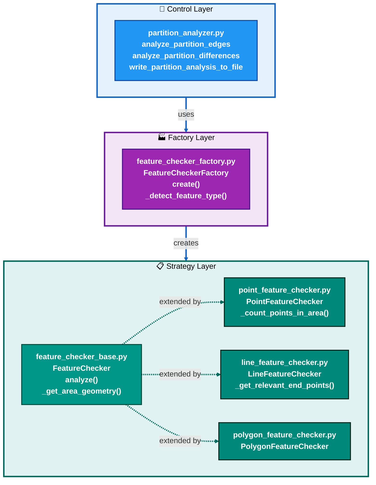
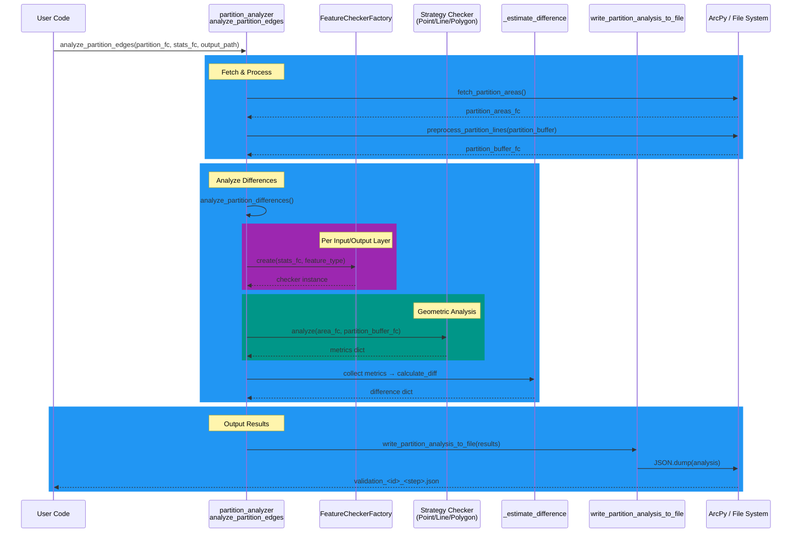

# Partition Validation

Analyzes how features (points, lines, polygons) interact with partition boundaries. Detects data quality issues at partition edges through geometric analysis.

**What it does:**
- **Lines** → Finds dangle endpoints (dead ends within partition buffer)
- **Points** → Counts features within partition area
- **Polygons** → Measures overlaps with partition area

---

## Quick Start

```python
from partition_validation.partition_analyzer import analyze_partition_edges

analyze_partition_edges(
    partition_iterator=partition_iter,
    input_fc="roads_before",
    output_fc="roads_after",
    partition_areas="partition_areas",
    partition_areas_dissolved="partition_dissolved",
    partition_lines="partition_lines",
    partition_buffer="partition_buffer",
    buffer_distance=500,
    id_field="GLOBAL_ID"
)
# Results → partition_analysis_<function>_<timestamp>.json
```

Or use a checker directly:

```python
from partition_validation.feature_checker_factory import FeatureCheckerFactory

checker = FeatureCheckerFactory.create(
    feature_layer="my_roads",
    area_fc="partition_buffer",
    id_field="GLOBAL_ID"
)
metrics = checker.analyze()
print(metrics)  # {"total_dangle_count": 5, "line_dangle_count": {...}, ...}
```

---

## Architecture



**Three layers:**
- **Control**: Orchestrates workflow (preprocessing, analysis, output)
- **Factory**: Auto-detects geometry type and creates appropriate checker
- **Strategy**: Implements type-specific analysis (pluggable)

---

## Return Values

Each checker returns type-specific metrics:

| Feature Type | Returns |
|------|---------|
| **Point** | `{"point_count": int}` |
| **Line** | `{"total_dangle_count": int, "line_dangle_count": dict, "line_dangle_ids": list}` |
| **Polygon** | `{"overlap_count": int, "overlap_area": float}` |

**Line example:**
```python
{
    "total_dangle_count": 5,
    "line_dangle_count": {101: 1, 102: 2, 103: 2},
    "line_dangle_ids": [101, 102, 103]
}
```
(Value is 1 or 2 depending on how many endpoints are within the area)

---

## Module Files

| File | Purpose |
|------|---------|
| `partition_analyzer.py` | Main orchestration & workflow |
| `feature_checker_factory.py` | Factory for creating type-specific checkers |
| `feature_checker_base.py` | Abstract base class |
| `point_feature_checker.py` | Point analysis (containment count) |
| `line_feature_checker.py` | Line analysis (dangle detection) |
| `polygon_feature_checker.py` | Polygon analysis (overlap detection) |
| `unique_identificator.py` | UUID field management (deprecated) |

---

## Design Patterns

**Factory** — Auto-detects geometry type and instantiates the correct checker  
**Strategy** — Each feature type implements the same `analyze()` interface differently  
**Abstract Base Class** — Enforces consistent interface across all checkers  

---

## Extending with New Feature Types

1. Create `my_type_feature_checker.py` and extend `FeatureChecker`
2. Import in `feature_checker_factory.py`
3. Add to `checker_map` dictionary
4. (Optional) Add type detection rule in `_detect_feature_type()`

That's it—no other changes needed.

---

## Pipeline Flow

```mermaid
graph LR
    A["Partition Iterator"] -->|partition areas| B["Partition Processor"]
    B -->|convert to lines| C["Polygon → Lines"]
    C -->|create buffer| D["Buffered Zone"]
    
    E["Input Feature Class"] -->|select & analyze| F["Factory Creates<br/>Checker"]
    H["Output Feature Class"] -->|select & analyze| F
    D -->|provides area| F
    
    F -->|detect type| G["Strategy Checker<br/>Point/Line/Polygon"]
    G -->|geometric analysis| I["Metrics Dict"]
    
    I -->|input vs output| J["Compute Difference"]
    J -->|add metadata| K["JSON Report"]
    
    style A fill:#E3F2FD,stroke:#1565C0,stroke-width:2px,color:#000
    style B fill:#E3F2FD,stroke:#1565C0,stroke-width:2px,color:#000
    style C fill:#E3F2FD,stroke:#1565C0,stroke-width:2px,color:#000
    style D fill:#FFF3E0,stroke:#F57C00,stroke-width:2px,color:#000,font-weight:bold
    style E fill:#E8F5E9,stroke:#2E7D32,stroke-width:2px,color:#000
    style H fill:#E8F5E9,stroke:#2E7D32,stroke-width:2px,color:#000
    style F fill:#F3E5F5,stroke:#6A1B9A,stroke-width:2px,color:#000
    style G fill:#E0F2F1,stroke:#00695C,stroke-width:2px,color:#000
    style I fill:#FCE4EC,stroke:#C2185B,stroke-width:2px,color:#000,font-weight:bold
    style J fill:#FCE4EC,stroke:#C2185B,stroke-width:2px,color:#000,font-weight:bold
    style K fill:#C8E6C9,stroke:#1B5E20,stroke-width:2px,color:#000,font-weight:bold
```



---

## Execution Sequence


